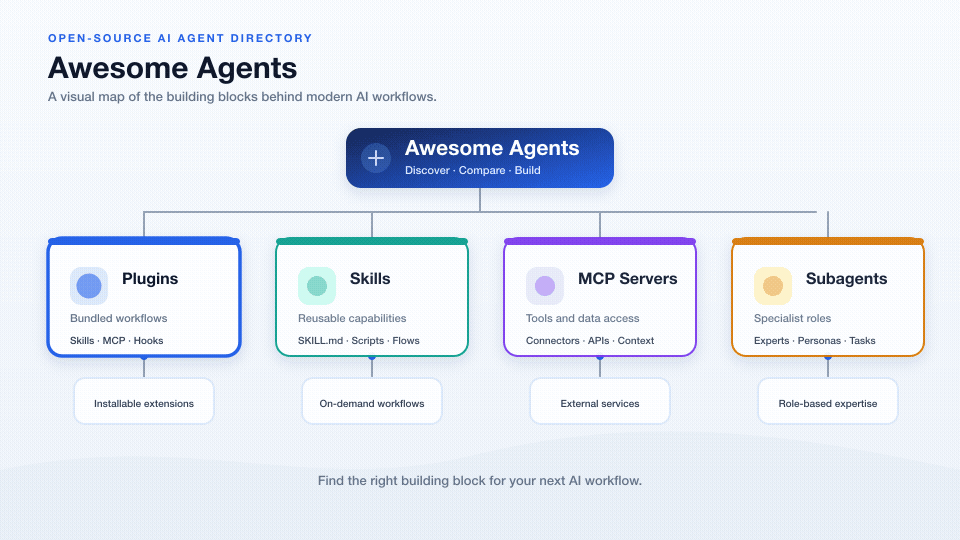

<!-- AUTO-GENERATED FILE. DO NOT EDIT DIRECTLY. Run `npm run build` instead. -->

# Awesome Agent Extensions

> Claude Code、Codex、Cursor、Gemini CLI、OpenCode、Antigravity などに対応した、Claude Code プラグイン、AI Agent Skills、MCP サーバー、Subagents、拡張ツールの横断型ディレクトリです。[NVIDIA/SkillSpector](https://github.com/NVIDIA/SkillSpector) による自動セキュリティスコア（0〜100）を掲載しています。

[English](README.md) | [简体中文](README.zh.md) | **日本語**

### Awesome Claude Code Plugins

Claude Code プラグインは、Skills、スラッシュコマンド、Subagents、Hooks、MCP サーバー、完全なワークフローを組み合わせられるインストール可能な拡張パッケージです。再利用可能な Agent ワークフローを共有したい場合に役立ちます。

[すべてのプラグイン (370)](docs/plugins.md) を確認し、`/plugin install <owner>/<repo>` でインストールするか、`/plugin marketplace add <owner>/<repo>` でマーケットプレイスを追加できます。

## クイックビュー

- [プラグイン (370)](docs/plugins.md) · [Skills (1039)](docs/skills.md) · [MCP・Connector (138)](docs/mcp.md) · [Subagent (65)](docs/subagents.md) · [拡張ツール (135)](docs/tools.md) · [Agent 別に見る](docs/by-agent.md) · [ベストプラクティス (51)](docs/guides.md)

クイックインストール

- **Claude Code Plugin**: `/plugin install <owner>/<repo>` または `/plugin marketplace add <owner>/<repo>`
- **クロスエージェント Skills**: `npx skills add <owner>/<repo>`
- **MCP Server**: 各プロジェクトのドキュメントに従い、Agent の MCP 設定（`mcpServers` など）に追加

## 対応 Agent

[Universal](https://agentskills.io) · [Claude Code](https://docs.anthropic.com/en/docs/claude-code) · [Codex](https://github.com/openai/codex) · [Cursor](https://cursor.com) · [Gemini CLI](https://github.com/google-gemini/gemini-cli) · [OpenCode](https://opencode.ai) · [Antigravity](https://antigravity.google) · [GitHub Copilot](https://github.com/features/copilot) · [Windsurf](https://windsurf.com) · [DeepSeek Harness](https://github.com/awesome-dsh-plugin/awesome-dsh-plugin) · [Kiro](https://kiro.dev) · [Cline](https://cline.bot) · [Pi](https://pi.dev)

### 🛡️ NVIDIA/SkillSpector による自動セキュリティスコア（0〜100）

このディレクトリに収録されたスキャン可能な **Skill、Plugin、MCP サーバー、Subagent** は、NVIDIA のオープンソース静的解析ツール [NVIDIA/SkillSpector](https://github.com/NVIDIA/SkillSpector) により自動監査されます。プロンプトインジェクション、データ流出、安全でない実行、サプライチェーンリスクなどを確認し、0〜100 の安全性スコア（高いほど安全）を付与します。

- **スコアの目安**：🟢 **80〜100** 安全 · 🟡 **50〜79** 注意 · 🔴 **0〜49** 高リスク（インストール非推奨） · `—` 未スキャンまたは対象外
- **CI による改ざん防止**：スコアは公式 [GitHub Actions ワークフロー](.github/workflows/security-scan.yml) のみが生成し、PR からの手動入力や変更をチェックで拒否します。
- **継続的で検証可能**：新しい項目はマージ時にスキャンし、上流リポジトリの更新時に再スキャンします。スコアのメタデータと日時は [`security/`](security/) に公開保存されます。

## Best Practices for AI Agents（ベストプラクティス）

- **[Best Practices for AI Agents (Universal)](docs/guides.md#best-practices-for-ai-agents-universal)**: [Agent Skills Overview](https://agentskills.io/home) · [Agent Skills Quickstart](https://agentskills.io/skill-creation/quickstart) · [Agent Skills Specification](https://agentskills.io/specification) · [すべて見る (4)](docs/guides.md#best-practices-for-ai-agents-universal)
- **[Best Practices for Claude Code](docs/guides.md#best-practices-for-claude-code)**: [Claude Code Best Practices (Anthropic Official)](https://www.anthropic.com/engineering/claude-code-best-practices) · [Claude Code Guide](https://github.com/zebbern/claude-code-guide) · [Claude Code Quickstart (Anthropic Official)](https://code.claude.com/docs/en/quickstart) · [すべて見る (5)](docs/guides.md#best-practices-for-claude-code)
- **[Best Practices for Codex](docs/guides.md#best-practices-for-codex)**: [Codex CLI (OpenAI Official)](https://learn.chatgpt.com/docs/codex/cli) · [Codex IDE Extension (OpenAI Official)](https://learn.chatgpt.com/docs/codex/ide) · [Codex Best Practices (OpenAI Official)](https://learn.chatgpt.com/guides/best-practices) · [すべて見る (4)](docs/guides.md#best-practices-for-codex)
- **[Best Practices for Cursor](docs/guides.md#best-practices-for-cursor)**: [Cursor Quickstart (Cursor Official)](https://cursor.com/docs/get-started/quickstart) · [Cursor Agent Overview (Cursor Official)](https://cursor.com/docs/agent/overview) · [Cursor Rules (Cursor Official)](https://cursor.com/docs/rules) · [すべて見る (4)](docs/guides.md#best-practices-for-cursor)
- **[Best Practices for Gemini CLI](docs/guides.md#best-practices-for-gemini-cli)**: [Get Started with Gemini CLI (Google Official)](https://geminicli.com/docs/get-started/) · [Provide Context with GEMINI.md Files (Google Official)](https://geminicli.com/docs/cli/gemini-md/) · [Manage Context and Memory (Google Official)](https://geminicli.com/docs/cli/tutorials/memory-management/)
- **[Best Practices for OpenCode](docs/guides.md#best-practices-for-opencode)**: [OpenCode Intro (OpenCode Official)](https://opencode.ai/docs/) · [OpenCode CLI Intro (OpenCode Official)](https://opencode.ai/docs/cli/) · [OpenCode Instructions (OpenCode Official)](https://opencode.ai/docs/instructions/)
- **[Best Practices for Antigravity](docs/guides.md#best-practices-for-antigravity)**: [Antigravity Getting Started (Google Official)](https://antigravity.google/docs/getting-started/) · [Antigravity CLI Best Practices (Google Official)](https://antigravity.google/docs/cli/best-practices/) · [Antigravity Rules (Google Official)](https://antigravity.google/docs/rules/) · [すべて見る (4)](docs/guides.md#best-practices-for-antigravity)
- **[Best Practices for GitHub Copilot](docs/guides.md#best-practices-for-github-copilot)**: [Quickstart for Using GitHub Copilot in Your IDE (GitHub Official)](https://docs.github.com/en/copilot/get-started/quickstart-for-using-github-copilot-in-your-ide) · [Best Practices for Using GitHub Copilot (GitHub Official)](https://docs.github.com/en/copilot/get-started/best-practices) · [Get Started with Copilot Agents on GitHub (GitHub Official)](https://docs.github.com/en/copilot/how-tos/copilot-on-github/use-copilot-agents/overview) · [すべて見る (4)](docs/guides.md#best-practices-for-github-copilot)
- **[Best Practices for Windsurf](docs/guides.md#best-practices-for-windsurf)**: [Devin Desktop Getting Started (Official)](https://docs.devin.ai/desktop/getting-started) · [Devin Desktop FAQ (Official)](https://docs.devin.ai/desktop/devin-desktop-faq) · [Devin Local Overview (Official)](https://docs.devin.ai/desktop/devin-local/overview) · [すべて見る (4)](docs/guides.md#best-practices-for-windsurf)
- **[Best Practices for DeepSeek Harness](docs/guides.md#best-practices-for-deepseek-harness)**: [DeepSeek Harness Web UI Quickstart (Official)](https://deepseek-harness.github.io/deepseek-harness/en/guide/quickstart) · [DeepSeek Harness README (Official)](https://github.com/deepseek-ai/deepseek-harness) · [Your First Plugin (Official)](https://deepseek-harness.github.io/deepseek-harness/en/develop/basic/)
- **[Best Practices for Kiro](docs/guides.md#best-practices-for-kiro)**: [Kiro Installation (Official)](https://kiro.dev/docs/getting-started/installation/) · [Your First Project (Official)](https://kiro.dev/docs/getting-started/first-project/) · [Kiro Steering (Official)](https://kiro.dev/docs/steering/) · [すべて見る (5)](docs/guides.md#best-practices-for-kiro)
- **[Best Practices for Cline](docs/guides.md#best-practices-for-cline)**: [Installing Cline (Official)](https://docs.cline.bot/getting-started/installing-cline) · [Using Cline in the IDE (Official)](https://docs.cline.bot/usage/ide) · [Cline Skills (Official)](https://docs.cline.bot/customization/skills) · [すべて見る (4)](docs/guides.md#best-practices-for-cline)
- **[Best Practices for Pi](docs/guides.md#best-practices-for-pi)**: [Pi Quickstart (Official)](https://docs.pi.dev/latest/quickstart) · [Agent Skills (Official)](https://docs.pi.dev/latest/skills) · [MCP Servers (Official)](https://docs.pi.dev/latest/mcp) · [すべて見る (4)](docs/guides.md#best-practices-for-pi)

## カテゴリ

- [公式・おすすめ (193)](#公式おすすめ)
- [コーディング・エンジニアリング (193)](#コーディングエンジニアリング) — コード生成、リファクタリング、テスト、デバッグ、コードレビュー、Git ワークフロー。
- [フロントエンド・デザイン (163)](#フロントエンドデザイン) — UI エンジニアリング、デザインシステム、ブラウザ自動化、ビジュアルテスト、Figma 連携。
- [クラウド・DevOps・インフラ (49)](#クラウドdevopsインフラ) — デプロイ、コンテナ、オブザーバビリティ、データベース、クラウドプラットフォーム連携。
- [Agent オーケストレーション・ワークフロー (171)](#agent-オーケストレーションワークフロー) — マルチ Agent 協調、計画パイプライン、メモリ層、ワークフロー自動化。
- [データ・リサーチ・ナレッジ (148)](#データリサーチナレッジ) — Web 検索、ドキュメント処理、データ分析、学術研究、ナレッジベース。
- [生産性・コラボレーション (169)](#生産性コラボレーション) — ドキュメント、課題管理、カレンダー、メッセージング、日々の業務ワークフロー。
- [コンテンツ・マーケティング (246)](#コンテンツマーケティング) — ライティング、SEO、ソーシャルメディア配信、動画・音声制作、グロースワークフロー。
- [セキュリティ・コンプライアンス (45)](#セキュリティコンプライアンス) — 脆弱性スキャン、シークレット検出、安全ガードレール、コンプライアンスチェック。
- [マーケットプレイス・仕様・ツール (53)](#マーケットプレイス仕様ツール) — プラグインマーケットプレイス、Skill レジストリ、クロスエージェントインストーラー、作成 SDK。

## 公式・おすすめ

| 名前 | 種類 | 説明 | 対応エージェント | 安全性 | アクティビティ |
| --- | --- | --- | --- | --- | --- |
| **[Anthropic Agent Skills](https://github.com/anthropics/skills)** `公式` | `Skill` | Official collection of Agent Skills by Anthropic covering document creation (docx, pdf, pptx), frontend design, and skill authoring. `npx skills add anthropics/skills` | `Universal` `Claude Code` | — | ⭐ 201.7k 2026-11-16 |
| **[MCP Reference Servers](https://github.com/modelcontextprotocol/servers)** `公式` | `MCP` | Official Model Context Protocol reference server collection demonstrating core integrations for files, Git, databases, and web access. | `Universal` | — | ⭐ 92.3k 2026-11-27 |
| **[Context7 MCP](https://github.com/upstash/context7)** `公式` | `MCP` | Official Upstash MCP server that fetches up-to-date, version-specific library documentation and code examples directly into AI agent prompts. `npx -y @upstash/context7-mcp` | `Universal` | — | ⭐ 65.6k 2026-11-28 |
| **[Chrome DevTools MCP](https://github.com/ChromeDevTools/chrome-devtools-mcp)** `公式` | `MCP` | Official Chrome DevTools MCP server allowing coding agents to inspect, debug, profile, and automate live Chrome browser sessions. `npx -y chrome-devtools-mcp@latest` | `Universal` | — | ⭐ 59.7k 2026-11-27 |
| **[Claude Code Official Plugins](https://github.com/anthropics/claude-plugins-official)** `公式` | `プラグイン` | Official Anthropic-managed plugin directory for Claude Code, bundling core workflow plugins, subagents, skills, hooks, and partner MCP integrations. `/plugin marketplace add anthropics/claude-plugins-official` | `Claude Code` | — | ⭐ 48.5k 2026-11-28 |
| **[Playwright MCP](https://github.com/microsoft/playwright-mcp)** `公式` | `MCP` | Official Microsoft MCP server enabling AI agents to drive browsers via structured accessibility snapshots for testing and web automation. `npx @playwright/mcp@latest` | `Universal` | 🔴 0/100 | ⭐ 40.2k 2026-11-27 |
| **[OpenAI Skills Catalog](https://github.com/openai/skills)** `公式` | `Skill` | Official OpenAI Skills Catalog providing curated, reusable SKILL.md workflows and tools for Codex and compatible agents. | `Codex` `Universal` | — | ⭐ 29.2k 2026-10-28 |
| **[FastMCP](https://github.com/PrefectHQ/fastmcp)** `公式` | `ツール` | The standard Python framework for rapidly building production-ready Model Context Protocol (MCP) servers and clients. | `Universal` | — | ⭐ 28.8k 2026-11-28 |
| **[Google Agent Skills](https://github.com/google/skills)** `公式` | `Skill` | Official Google repository of Agent Skills for building with Google Cloud, developer platforms, and Google technologies. | `Universal` `Gemini CLI` `Claude Code` | — | ⭐ 24.9k 2026-11-27 |
| **[MarkItDown](https://github.com/microsoft/markitdown)** `公式` | `MCP` | Official Microsoft Python tool and MCP server for converting PDFs, Office documents, images, audio, and web pages into LLM-friendly Markdown. | `Universal` | — | ⭐ 198.8k 2026-11-07 |
| **[shadcn/ui Skill](https://github.com/shadcn-ui/ui)** `公式` | `Skill` | Official shadcn/ui repository with built-in agent skill and CLI context for managing components, themes, and modern React design systems. | `Universal` `Claude Code` | — | ⭐ 129.3k 2026-11-27 |
| **[Hyperframes](https://github.com/heygen-com/hyperframes)** `公式` | `プラグイン` | Official HeyGen open-source AI video editor plugin and MCP suite for authoring HTML animations and rendering MP4. | `Claude Code` `Codex` `Cursor` `Gemini CLI` | — | ⭐ 91.7k 2026-11-28 |
| **[Cloudflare Security Audit Skill](https://github.com/cloudflare/security-audit-skill)** `公式` | `Skill` | Official Cloudflare coding-agent skill for multi-phase security audits with verified, machine-readable findings. | `Universal` | 🔴 0/100 | ⭐ 79.4k 2026-09-14 |
| **[Open Code Review](https://github.com/alibaba/open-code-review)** `公式` | `ツール` | Official Alibaba hybrid code review tool combining deterministic rule pipelines with LLM agents for line-level reviews. | `Universal` | — | ⭐ 57.0k 2026-11-26 |
| **[Obsidian Skills](https://github.com/obsidianmd/obsidian-skills)** `公式` | `Skill` | Official Obsidian skills teaching AI agents to work with Obsidian vaults, Markdown, Bases, and JSON Canvas. | `Claude Code` `Codex` `Cursor` `OpenCode` | 🔴 32/100 | ⭐ 54.5k 2026-11-26 |
| **[Agent Browser](https://github.com/vercel-labs/agent-browser)** `公式` | `ツール` | Official Vercel headless browser automation CLI and skill designed for AI coding agents. | `Universal` | — | ⭐ 54.4k 2026-11-27 |
| **[Vercel Skills CLI](https://github.com/vercel-labs/skills)** `公式` | `ツール` | Official open CLI (`npx skills`) for discovering, installing, and managing cross-agent skills from skills.sh. | `Universal` | — | ⭐ 41.2k 2026-11-27 |
| **[Vercel Agent Skills](https://github.com/vercel-labs/agent-skills)** `公式` | `Skill` | Official Vercel collection of agent skills covering React best practices, web design guidelines, and deployment. | `Universal` | — | ⭐ 35.1k 2026-11-20 |
| **[Video Use](https://github.com/browser-use/video-use)** `公式` | `Skill` | Official Browser Use agent skill enabling AI coding agents to edit and process videos programmatically. | `Universal` | 🔴 0/100 | ⭐ 31.7k 2026-10-08 |
| **[DESIGN.md](https://github.com/google-labs-code/design.md)** `公式` | `ツール` | Official Google Labs format specification and tooling for giving coding agents persistent design system context. | `Universal` | — | ⭐ 29.2k 2026-11-18 |

_20 件を表示しています（全 193 件）。完全な一覧は [Plugins](docs/plugins.md) · [Skills](docs/skills.md) · [MCP](docs/mcp.md) · [Subagents](docs/subagents.md) · [Tooling](docs/tools.md) · [Agent 別](docs/by-agent.md) をご覧ください。_

## コーディング・エンジニアリング

_コード生成、リファクタリング、テスト、デバッグ、コードレビュー、Git ワークフロー。_

| 名前 | 種類 | 説明 | 対応エージェント | 安全性 | アクティビティ |
| --- | --- | --- | --- | --- | --- |
| **[Context7 MCP](https://github.com/upstash/context7)** `公式` | `MCP` | Official Upstash MCP server that fetches up-to-date, version-specific library documentation and code examples directly into AI agent prompts. `npx -y @upstash/context7-mcp` | `Universal` | — | ⭐ 65.6k 2026-11-28 |
| **[OpenAI Skills Catalog](https://github.com/openai/skills)** `公式` | `Skill` | Official OpenAI Skills Catalog providing curated, reusable SKILL.md workflows and tools for Codex and compatible agents. | `Codex` `Universal` | — | ⭐ 29.2k 2026-10-28 |
| **[Open Code Review](https://github.com/alibaba/open-code-review)** `公式` | `ツール` | Official Alibaba hybrid code review tool combining deterministic rule pipelines with LLM agents for line-level reviews. | `Universal` | — | ⭐ 57.0k 2026-11-26 |
| **[Agent Browser](https://github.com/vercel-labs/agent-browser)** `公式` | `ツール` | Official Vercel headless browser automation CLI and skill designed for AI coding agents. | `Universal` | — | ⭐ 54.4k 2026-11-27 |
| **[Elephant Goldfish Model](https://github.com/google/elephant-goldfish-model)** `公式` | `プラグイン` | Official Google open-source plugin for spec-driven software design and structured code review with coding agents. | `Claude Code` `Codex` `Cursor` `Gemini CLI` `+3` | — | ⭐ 23.5k 2026-11-25 |
| **[Browser Harness](https://github.com/browser-use/browser-harness)** `公式` | `ツール` | Official Browser Use harness letting Claude Code, Codex, and Cursor drive your real logged-in Chrome browser. | `Claude Code` `Codex` `Cursor` | — | ⭐ 19.3k 2026-11-28 |
| **[MiniMax Agent Skills](https://github.com/MiniMax-AI/skills)** `公式` | `Skill` | Official collection of MiniMax AI agent skills and multi-harness plugins for coding and productivity workflows. | `Claude Code` `Codex` `Cursor` `OpenCode` | — | ⭐ 13.9k 2026-11-10 |
| **[Android Agent Skills](https://github.com/android/skills)** `公式` | `Skill` | Official Android development agent skills covering Jetpack Compose, build systems, testing, performance, security, Wear, TV, and XR. | `Universal` `Claude Code` `Codex` | — | ⭐ 10.8k 2026-11-23 |
| **[HumanLayer Skills](https://github.com/humanlayer/skills)** `公式` | `Skill` | Official HumanLayer collection of Claude Code skills and plugins for structured research, planning, and implementation workflows. | `Claude Code` `Universal` | — | ⭐ 6.0k 2026-11-01 |
| **[Expo Agent Skills](https://github.com/expo/skills)** `公式` | `Skill` | Official Expo collection of AI agent skills for building, configuring, and shipping React Native apps with Expo and EAS. | `Universal` `Claude Code` | — | ⭐ 4.3k 2026-11-27 |
| **[Laravel Boost](https://github.com/laravel/boost)** `公式` | `MCP` | Official Laravel MCP server that augments AI-assisted local Laravel development with framework-aware context and tools. | `Universal` | — | ⭐ 3.7k 2026-11-28 |
| **[Vue 3 Agent Skills](https://github.com/vuejs-ai/skills)** `公式` | `Skill` | Official Vue.js AI agent skills providing idiomatic Vue 3 Composition API, reactivity, and component development guidance. | `Universal` | — | ⭐ 3.4k 2026-10-23 |
| **[Stripe AI](https://github.com/stripe/ai)** `公式` | `プラグイン` | Official Stripe AI suite bundling agent toolkits, MCP integrations, CLI extensions, and skills for building AI-powered payment workflows. | `Universal` | — | ⭐ 2.1k 2026-11-25 |
| **[Callstack React Native Agent Skills](https://github.com/callstackincubator/agent-skills)** `公式` | `Skill` | Official Callstack collection of agent-optimized React Native skills for mobile architecture, debugging, and performance tuning. | `Universal` | — | ⭐ 1.7k 2026-10-08 |
| **[ast-grep Agent Skill](https://github.com/ast-grep/agent-skill)** `公式` | `Skill` | Official ast-grep agent skill for structural code search, linting, and AST-based refactoring. | `Universal` | — | ⭐ 914 2026-11-04 |
| **[MiniMax mcode-stack](https://github.com/MiniMax-AI/mcode-stack)** `公式` | `Skill` | Official engineering workflows and Agent Skills used internally by the MiniMax Code team to build MiniMax Code. | `Claude Code` `Universal` | — | ⭐ 748 2026-11-11 |
| **[Code Graph MCP](https://github.com/diffbot/mcp-code-graph)** `公式` | `MCP` | MCP server by CodeGPT/Diffbot for codebase knowledge graph analysis, dependency exploration, and architecture visualization. | `Universal` | — | ⭐ 401 2025-11-25 |
| **[Han (Test Double)](https://github.com/testdouble/han)** `公式` | `プラグイン` | AI skills and agents by Test Double tailored for solo product engineers and small teams covering code review, docs, and investigation. | `Claude Code` | — | ⭐ 360 2026-11-12 |
| **[Resend Agent Skills](https://github.com/resend/resend-skills)** `公式` | `Skill` | Official Resend agent skills for integrating email sending and receiving into applications. | `Universal` | — | ⭐ 220 2026-11-27 |
| **[MATLAB & Simulink Agent Skills](https://github.com/matlab/agent-skills-playground)** `公式` | `Skill` | Official MathWorks Agent Skills playground for prototyping and running MATLAB and Simulink engineering workflows. | `Claude Code` `Universal` | — | ⭐ 206 2026-10-14 |

_20 件を表示しています（全 193 件）。完全な一覧は [Plugins](docs/plugins.md) · [Skills](docs/skills.md) · [MCP](docs/mcp.md) · [Subagents](docs/subagents.md) · [Tooling](docs/tools.md) · [Agent 別](docs/by-agent.md) をご覧ください。_

## フロントエンド・デザイン

_UI エンジニアリング、デザインシステム、ブラウザ自動化、ビジュアルテスト、Figma 連携。_

| 名前 | 種類 | 説明 | 対応エージェント | 安全性 | アクティビティ |
| --- | --- | --- | --- | --- | --- |
| **[Chrome DevTools MCP](https://github.com/ChromeDevTools/chrome-devtools-mcp)** `公式` | `MCP` | Official Chrome DevTools MCP server allowing coding agents to inspect, debug, profile, and automate live Chrome browser sessions. `npx -y chrome-devtools-mcp@latest` | `Universal` | — | ⭐ 59.7k 2026-11-27 |
| **[Playwright MCP](https://github.com/microsoft/playwright-mcp)** `公式` | `MCP` | Official Microsoft MCP server enabling AI agents to drive browsers via structured accessibility snapshots for testing and web automation. `npx @playwright/mcp@latest` | `Universal` | 🔴 0/100 | ⭐ 40.2k 2026-11-27 |
| **[shadcn/ui Skill](https://github.com/shadcn-ui/ui)** `公式` | `Skill` | Official shadcn/ui repository with built-in agent skill and CLI context for managing components, themes, and modern React design systems. | `Universal` `Claude Code` | — | ⭐ 129.3k 2026-11-27 |
| **[Vercel Agent Skills](https://github.com/vercel-labs/agent-skills)** `公式` | `Skill` | Official Vercel collection of agent skills covering React best practices, web design guidelines, and deployment. | `Universal` | — | ⭐ 35.1k 2026-11-20 |
| **[DESIGN.md](https://github.com/google-labs-code/design.md)** `公式` | `ツール` | Official Google Labs format specification and tooling for giving coding agents persistent design system context. | `Universal` | — | ⭐ 29.2k 2026-11-18 |
| **[Modern Web Guidance](https://github.com/GoogleChrome/modern-web-guidance)** `公式` | `Skill` | Official Google Chrome guidance skills keeping AI coding agents aligned with modern web platform best practices. | `Claude Code` `Codex` `Cursor` `Gemini CLI` | — | ⭐ 27.2k 2026-11-23 |
| **[GSAP Skills](https://github.com/greensock/gsap-skills)** `公式` | `Skill` | Official GSAP AI skills teaching coding agents animation patterns, plugins, and GreenSock best practices. | `Claude Code` `Cursor` `Gemini CLI` | 🔴 2/100 | ⭐ 19.2k 2026-07-29 |
| **[Playwright CLI](https://github.com/microsoft/playwright-cli)** `公式` | `ツール` | Official Playwright CLI and agent skills for recording actions, generating Playwright code, inspecting selectors, and capturing screenshots. | `Universal` `Claude Code` | — | ⭐ 15.5k 2026-11-24 |
| **[e2e Agent Skill](https://github.com/e2e-inc/e2e)** `公式` | `Skill` | Official skill for the e2e agentic test runner that writes, executes, and debugs end-to-end tests across Playwright browsers, iOS, and Android. | `Universal` `Claude Code` | — | ⭐ 14.5k 2026-11-28 |
| **[Google Stitch Skills](https://github.com/google-labs-code/stitch-skills)** `公式` | `Skill` | Official Google Labs library of open-standard Agent Skills designed to pair with the Stitch MCP server for UI and frontend workflows. | `Universal` `Antigravity` `Gemini CLI` `Claude Code` `+1` | 🔴 0/100 | ⭐ 13.7k 2026-11-28 |
| **[Browser MCP](https://github.com/BrowserMCP/mcp)** `公式` | `MCP` | MCP server and browser extension letting AI agents automate your local browser using existing sessions and profiles. `npx -y @browsermcp/mcp@latest` | `Universal` | — | ⭐ 7.4k 2026-11-12 |
| **[BrowserAct Skills](https://github.com/browser-act/skills)** `公式` | `Skill` | Official BrowserAct agent skills and CLI workflows for browser automation, handling anti-bot checks, and web data tasks. | `Universal` `Claude Code` | — | ⭐ 6.4k 2026-11-04 |
| **[Diffusion Studio Lottie](https://github.com/diffusionstudio/lottie)** `公式` | `Skill` | Official Diffusion Studio skill for generating and previewing production-ready Lottie animations with Claude Code or Codex. | `Claude Code` `Codex` `Universal` | — | ⭐ 5.8k 2026-07-25 |
| **[LottieFiles Motion Design Skill](https://github.com/LottieFiles/motion-design-skill)** `公式` | `Skill` | Official LottieFiles skill teaching universal UI motion design principles including timing, easing, choreography, and animation craft. | `Universal` | — | ⭐ 3.8k 2026-11-23 |
| **[Angular Official Skills](https://github.com/angular/skills)** `公式` | `Skill` | Official Angular agent skills for building new Angular apps and following modern Angular development practices. | `Universal` | — | ⭐ 738 2026-11-25 |
| **[Sleek Design Agent Skills](https://github.com/sleekdotdesign/agent-skills)** `公式` | `Skill` | Official Sleek agent skill for creating and editing mobile app screen designs via the Sleek REST API. | `Universal` | — | ⭐ 604 2026-10-05 |
| **[Refero Design Research Skill](https://github.com/referodesign/refero_skill)** `公式` | `プラグイン` | Official Refero research-first UI design plugin giving agents access to 150K+ real-world app screens and user flows via MCP. | `Claude Code` `Codex` `Cursor` `Universal` | — | ⭐ 370 2026-11-25 |
| **[Svelte Official MCP](https://github.com/sveltejs/ai-tools)** `公式` | `MCP` | Official Svelte MCP server and AI tooling for Svelte and SvelteKit development. | `Universal` | — | ⭐ 347 2026-11-28 |
| **[CesiumJS Agent Skills](https://github.com/CesiumGS/cesiumjs-skills)** `公式` | `プラグイン` | Official CesiumGS agent skills for building 3D geospatial globes, 3D Tiles, and CesiumJS web visualizations. | `Claude Code` `Codex` `GitHub Copilot` `Universal` | — | ⭐ 198 2026-09-14 |
| **[UX Pilot Frontend Design Skill](https://github.com/uxpilot-ai/frontend-design-skill)** `公式` | `Skill` | Official UX Pilot skill that generates UI designs on a visual canvas first and then translates them cleanly into frontend code. | `Claude Code` `Codex` `Cursor` `Universal` | — | ⭐ 197 2026-11-25 |

_20 件を表示しています（全 163 件）。完全な一覧は [Plugins](docs/plugins.md) · [Skills](docs/skills.md) · [MCP](docs/mcp.md) · [Subagents](docs/subagents.md) · [Tooling](docs/tools.md) · [Agent 別](docs/by-agent.md) をご覧ください。_

## クラウド・DevOps・インフラ

_デプロイ、コンテナ、オブザーバビリティ、データベース、クラウドプラットフォーム連携。_

| 名前 | 種類 | 説明 | 対応エージェント | 安全性 | アクティビティ |
| --- | --- | --- | --- | --- | --- |
| **[Google Agent Skills](https://github.com/google/skills)** `公式` | `Skill` | Official Google repository of Agent Skills for building with Google Cloud, developer platforms, and Google technologies. | `Universal` `Gemini CLI` `Claude Code` | — | ⭐ 24.9k 2026-11-27 |
| **[Google Agents CLI](https://github.com/google/agents-cli)** `公式` | `ツール` | Official Google CLI and skills enabling coding assistants to build, evaluate, and deploy AI agents on Google Cloud with ADK. | `Universal` `Claude Code` `Gemini CLI` | — | ⭐ 6.4k 2026-11-24 |
| **[DBHub MCP](https://github.com/bytebase/dbhub)** `公式` | `MCP` | Token-conscious universal database MCP server supporting PostgreSQL, MySQL, SQL Server, Oracle, MariaDB, and SQLite. `npx -y @bytebase/dbhub` | `Universal` | — | ⭐ 4.0k 2026-11-25 |
| **[Cloudflare Skills](https://github.com/cloudflare/skills)** `公式` | `Skill` | Official Cloudflare agent skills and rules teaching AI assistants how to build and deploy on Cloudflare Workers and developer platform. | `Universal` | — | ⭐ 3.5k 2026-11-25 |
| **[Supabase Agent Skills](https://github.com/supabase/agent-skills)** `公式` | `Skill` | Official Supabase agent skills helping AI coding assistants follow Postgres, auth, RLS, and Edge Functions best practices. | `Universal` | — | ⭐ 3.1k 2026-11-12 |
| **[Supabase MCP](https://github.com/supabase/mcp)** `公式` | `MCP` | Official Supabase MCP server connecting AI assistants to Supabase projects for SQL queries, schema migrations, edge functions, and logs. `npx -y @supabase/mcp-server-supabase` | `Universal` | — | ⭐ 3.0k 2026-11-28 |
| **[PostgreSQL AI Guide](https://github.com/timescale/pg-aiguide)** `公式` | `プラグイン` | Official Timescale MCP server and Claude plugin providing PostgreSQL skills, versioned documentation, and best practices. | `Claude Code` `Universal` | — | ⭐ 1.9k 2026-11-26 |
| **[Terraform MCP Server](https://github.com/hashicorp/terraform-mcp-server)** `公式` | `MCP` | Query providers and modules in the Terraform Registry and manage HCP Terraform workspaces from an MCP client. `codex mcp add terraform -- docker run -i --rm hashicorp/terraform-mcp-server` | `Claude Code` `Codex` `Cursor` `Gemini CLI` `+1` | — | ⭐ 1.6k 2026-11-25 |
| **[MongoDB MCP Server](https://github.com/mongodb-js/mongodb-mcp-server)** `公式` | `MCP` | Official MongoDB MCP server for querying collections, inspecting schemas, and managing MongoDB Atlas deployments. `npx -y mongodb-mcp-server` | `Universal` | — | ⭐ 1.2k 2026-11-27 |
| **[Sentry Agentic Toolkit](https://github.com/getsentry/toolkit)** `公式` | `プラグイン` | Official Sentry agentic tooling combining MCP capabilities and skills for diagnosing production errors and tracing regressions. | `Universal` `Claude Code` | — | ⭐ 976 2026-11-28 |
| **[HashiCorp Agent Skills](https://github.com/hashicorp/agent-skills)** `公式` | `Skill` | HashiCorp-maintained agent skills for Terraform workflows and infrastructure automation. | `Claude Code` `Universal` | — | ⭐ 942 2026-11-04 |
| **[Redis MCP Server](https://github.com/redis/mcp-redis)** `公式` | `MCP` | Official Redis MCP server providing a natural-language interface for AI agents to query, manage, and inspect Redis data. | `Universal` | — | ⭐ 644 2026-11-27 |
| **[Cloud Run MCP](https://github.com/GoogleCloudPlatform/cloud-run-mcp)** `公式` | `MCP` | Official Google Cloud MCP server allowing AI agents to build, deploy, and manage containerized applications on Cloud Run. `npx -y @google-cloud/cloud-run-mcp` | `Universal` | — | ⭐ 641 2026-11-27 |
| **[Firebase Agent Skills](https://github.com/firebase/agent-skills)** `公式` | `Skill` | Official Firebase agent skills and extensions for building, configuring, and deploying Firebase backends. | `Universal` | — | ⭐ 533 2026-11-09 |
| **[Railway Agent Skills](https://github.com/railwayapp/railway-skills)** `公式` | `Skill` | Official Railway agent skills for provisioning services, managing environments, inspecting logs, and deploying apps on Railway. | `Universal` `Claude Code` | — | ⭐ 346 2026-11-27 |
| **[Qdrant Skills](https://github.com/qdrant/skills)** `公式` | `Skill` | Official agent skills for Qdrant vector search operations, performance tuning, deployment, upgrades, and SDK usage. | `Claude Code` `Universal` | — | ⭐ 270 2026-11-26 |
| **[TraxAgent Budget Governance](https://github.com/ccarter01011/traxagent-claude-plugin)** `公式` | `プラグイン` | Read-only AI spend analytics plugin and MCP server answering who spent your AI budget and recommending concrete cost fixes. | `Claude Code` `Cursor` `Universal` | — | ⭐ 172 2026-11-24 |
| **[Pydantic Logfire MCP](https://github.com/pydantic/logfire-mcp)** `公式` | `MCP` | Official Pydantic Logfire MCP server letting AI agents query OpenTelemetry traces, exceptions, and production metrics. `uvx logfire-mcp` | `Universal` | — | ⭐ 162 2026-07-13 |
| **[JetBrains TeamCity CLI & Skill](https://github.com/JetBrains/teamcity-cli)** `公式` | `Skill` | Official JetBrains TeamCity CLI and agent skill for inspecting CI builds, logs, build agents, terminals, and build queues. | `Claude Code` `Universal` | — | ⭐ 132 2026-11-25 |
| **[Neo4j Agent Skills](https://github.com/neo4j/agent-skills)** `公式` | `Skill` | Official Neo4j agent skills for Cypher query authoring, graph data modeling, and Neo4j application development. | `Claude Code` `Codex` `Gemini CLI` `Universal` | — | ⭐ 124 2026-11-27 |

_20 件を表示しています（全 49 件）。完全な一覧は [Plugins](docs/plugins.md) · [Skills](docs/skills.md) · [MCP](docs/mcp.md) · [Subagents](docs/subagents.md) · [Tooling](docs/tools.md) · [Agent 別](docs/by-agent.md) をご覧ください。_

## Agent オーケストレーション・ワークフロー

_マルチ Agent 協調、計画パイプライン、メモリ層、ワークフロー自動化。_

| 名前 | 種類 | 説明 | 対応エージェント | 安全性 | アクティビティ |
| --- | --- | --- | --- | --- | --- |
| **[Honcho](https://github.com/plastic-labs/honcho)** `公式` | `ツール` | Official Plastic Labs memory infrastructure, CLI, MCP server, and harness plugins for building stateful, continually learning agents. | `Universal` `Claude Code` `Cursor` `DeepSeek Harness` | — | ⭐ 8.3k 2026-11-25 |
| **[MemSearch](https://github.com/zilliztech/memsearch)** `公式` | `プラグイン` | Official Zilliz persistent unified memory layer for Claude Code, Codex, and DSH backed by local Markdown and Milvus vector search. | `Claude Code` `Codex` `DeepSeek Harness` `Universal` | — | ⭐ 3.0k 2026-11-27 |
| **[Claude Brain (Memvid)](https://github.com/memvid/claude-brain)** `公式` | `プラグイン` | Rust-powered photographic memory plugin storing Claude Code memory in a single portable .mv2 file you can git commit or share. | `Claude Code` | — | ⭐ 585 2026-01-19 |
| **[ClickHouse Loom](https://github.com/ClickHouse/loom)** `公式` | `プラグイン` | Official ClickHouse shared long-term memory, document search, and symbol-linked code index plugin for AI coding agents. | `Claude Code` `Universal` | — | ⭐ 248 2026-11-28 |
| **[Corezoid AI Plugin](https://github.com/corezoid/corezoid-ai-plugin)** `公式` | `プラグイン` | Official Corezoid plugin providing workflow skills, schemas, templates, playbooks, and MCP references for building Corezoid processes. | `Claude Code` `Codex` | — | ⭐ 74 2026-11-13 |
| **[Superpowers](https://github.com/obra/superpowers)** | `プラグイン` | Structured software development workflow framework enforcing brainstorming, TDD, systematic debugging, and subagent-driven execution. `/plugin install obra/superpowers` | `Claude Code` `Codex` `Cursor` `OpenCode` | — | ⭐ 328.6k 2026-11-28 |
| **[Oh My ClaudeCode](https://github.com/Yeachan-Heo/oh-my-claudecode)** | `プラグイン` | Teams-first multi-agent orchestration plugin for Claude Code combining specialized subagents, skills, hooks, and parallel execution. | `Claude Code` | — | ⭐ 41.1k 2026-11-28 |
| **[Vibe Kanban](https://github.com/BloopAI/vibe-kanban)** | `ツール` | Visual Kanban orchestrator for running, monitoring, and reviewing parallel coding tasks across Claude Code, Codex, and other agents. | `Claude Code` `Codex` `Universal` | — | ⭐ 28.8k 2026-11-28 |
| **[pstack Multi-Harness Plugin](https://github.com/michael-denyer/pstack-claude)** | `プラグイン` | Rigorous agent workflows translating Cursor primitives across Claude Code, Codex, Copilot, Gemini CLI, OpenCode, Antigravity, and DeepSeek Harness. | `Claude Code` `Codex` `GitHub Copilot` `Gemini CLI` `+3` | — | ⭐ 5.0k 2026-11-27 |
| **[Token Optimizer](https://github.com/alexgreensh/token-optimizer)** | `プラグイン` | Detect ghost tokens, survive context compaction, and prevent context quality decay in long coding agent sessions. | `Claude Code` `Codex` | — | ⭐ 3.2k 2026-11-28 |
| **[LongHorizon Harness](https://github.com/AMAP-ML/LongHorizon-Harness)** | `プラグイン` | Long-horizon computer-use harness for running agents across desktop apps and CLI with fresh-context execution, durable state, and independent auditing. | `Claude Code` `Codex` `DeepSeek Harness` | — | ⭐ 1.9k 2026-11-11 |
| **[Everything Claude Code (ECC)](https://github.com/affaan-m/ECC)** | `プラグイン` | Agent harness optimization system bundling skills, instincts, memory, security, and research-first workflows. | `Claude Code` `Codex` `OpenCode` `Cursor` `+2` | — | ⭐ 312.1k 2026-11-23 |
| **[Claude Mem](https://github.com/thedotmack/claude-mem)** | `プラグイン` | Persistent cross-session memory plugin that captures, compresses, and injects relevant agent context. | `Claude Code` `Codex` `Cursor` `Gemini CLI` `+2` | — | ⭐ 120.3k 2026-11-28 |
| **[Ruflo (Claude Flow)](https://github.com/ruvnet/ruflo)** | `プラグイン` | Multi-agent orchestration platform for Claude Code and Codex with coordinated agent swarms, memory, skills, and MCP integration. | `Claude Code` `Codex` `Universal` | — | ⭐ 82.6k 2026-11-28 |
| **[Oh My OpenAgent (OmO)](https://github.com/code-yeongyu/oh-my-openagent)** | `プラグイン` | Multi-agent orchestration harness and plugin for OpenCode and coding agents with graph engineering workflows. | `OpenCode` `Claude Code` `Codex` `Cursor` `+1` | — | ⭐ 71.2k 2026-11-28 |
| **[Context Mode](https://github.com/mksglu/context-mode)** | `プラグイン` | Zero-telemetry local plugin using sandboxing and SQLite FTS5 search to keep bulky tool outputs out of agent context. | `Claude Code` `Codex` `Gemini CLI` `GitHub Copilot` `+2` | — | ⭐ 34.6k 2026-11-28 |
| **[AgentMemory](https://github.com/rohitg00/agentmemory)** | `Skill` | Durable cross-session memory plugin and skill suite for storing, recalling, handing off, recapping, and pruning agent memories and lessons. | `Universal` `Claude Code` | — | ⭐ 30.6k 2026-11-27 |
| **[Planning with Files](https://github.com/OthmanAdi/planning-with-files)** | `Skill` | Manus-style persistent markdown planning skill providing crash-proof session recovery and context-rot protection. | `Universal` | — | ⭐ 28.3k 2026-11-25 |
| **[n8n MCP](https://github.com/czlonkowski/n8n-mcp)** | `MCP` | MCP server enabling Claude, Cursor, and other AI agents to search nodes, inspect schemas, and build or operate n8n automation workflows. `npx -y n8n-mcp` | `Universal` | — | ⭐ 23.3k 2026-11-27 |
| **[PUA Skill](https://github.com/tanweai/pua)** | `Skill` | High-pressure motivation skill that pushes AI agents to exhaust all debugging and problem-solving options before giving up. | `Claude Code` `Universal` | — | ⭐ 19.9k 2026-09-09 |

_20 件を表示しています（全 171 件）。完全な一覧は [Plugins](docs/plugins.md) · [Skills](docs/skills.md) · [MCP](docs/mcp.md) · [Subagents](docs/subagents.md) · [Tooling](docs/tools.md) · [Agent 別](docs/by-agent.md) をご覧ください。_

## データ・リサーチ・ナレッジ

_Web 検索、ドキュメント処理、データ分析、学術研究、ナレッジベース。_

| 名前 | 種類 | 説明 | 対応エージェント | 安全性 | アクティビティ |
| --- | --- | --- | --- | --- | --- |
| **[MarkItDown](https://github.com/microsoft/markitdown)** `公式` | `MCP` | Official Microsoft Python tool and MCP server for converting PDFs, Office documents, images, audio, and web pages into LLM-friendly Markdown. | `Universal` | — | ⭐ 198.8k 2026-11-07 |
| **[Screenpipe](https://github.com/screenpipe/screenpipe)** `公式` | `ツール` | Local-first screen and audio recording engine with agent skills to query meeting, screen, and interface context. | `Claude Code` `Universal` | — | ⭐ 22.6k 2026-11-28 |
| **[Apify MCP Server](https://github.com/apify/apify-mcp-server)** `公式` | `MCP` | Official Apify MCP server giving AI agents access to thousands of Actors for web scraping, crawling, and structured data extraction. `npx -y @apify/actors-mcp-server` | `Universal` | — | ⭐ 18.2k 2026-11-27 |
| **[Hugging Face Skills](https://github.com/huggingface/skills)** `公式` | `Skill` | Skills for querying Hugging Face Hub datasets, fine-tuning models, and running model evaluations. `hf skills add huggingface-datasets` | `Claude Code` `Codex` `Cursor` `Gemini CLI` | — | ⭐ 11.4k 2026-11-26 |
| **[Firecrawl MCP Server](https://github.com/firecrawl/firecrawl-mcp-server)** `公式` | `MCP` | Official Firecrawl MCP server providing web search, scraping, crawling, and structured data extraction for AI agents. `npx -y firecrawl-mcp` | `Universal` | — | ⭐ 7.9k 2026-11-27 |
| **[Microsoft Learn MCP](https://github.com/MicrosoftDocs/mcp)** `公式` | `MCP` | Official Microsoft Learn MCP server and CLI providing AI agents with up-to-date Microsoft, Azure, and .NET documentation. | `Universal` | — | ⭐ 2.0k 2026-11-13 |
| **[ktx Analytics Context](https://github.com/Kaelio/ktx)** `公式` | `Skill` | Executable semantic context layer enabling Claude Code and Codex to query analytical databases accurately with business definitions. | `Claude Code` `Codex` `Universal` | — | ⭐ 1.6k 2026-11-18 |
| **[Alpaca MCP Server](https://github.com/alpacahq/alpaca-mcp-server)** `公式` | `MCP` | Official Alpaca MCP server enabling AI agents to fetch real-time market data and trade stocks, ETFs, options, and crypto. `uvx alpaca-mcp-server` | `Universal` | — | ⭐ 1.1k 2026-11-24 |
| **[Oxylabs Agent Skills](https://github.com/oxylabs/agent-skills)** `公式` | `Skill` | Official Oxylabs agent skills for structured web scraping, browser rendering, and real-time search data extraction. | `Claude Code` `Universal` | — | ⭐ 867 2026-11-27 |
| **[Posit Data Science Skills](https://github.com/posit-dev/skills)** `公式` | `プラグイン` | Official Claude Skills maintained by Posit for R, Python, Quarto, Shiny, and reproducible data science workflows. | `Claude Code` `Universal` | — | ⭐ 576 2026-11-12 |
| **[AntV Chart Visualization Skills](https://github.com/antvis/chart-visualization-skills)** `公式` | `Skill` | Official AntV agent skills for data visualization and turning structured data into clear charts. | `Universal` | — | ⭐ 545 2026-09-22 |
| **[Tavily Agent Skills](https://github.com/tavily-ai/skills)** `公式` | `Skill` | Official Tavily agent skills for web search, content extraction, and real-time online research. | `Universal` | — | ⭐ 497 2026-11-24 |
| **[Apify Awesome Skills](https://github.com/apify/awesome-skills)** `公式` | `Skill` | Official Apify skills for collecting Reddit posts, comments, profiles, communities, and structured web data. | `Claude Code` `Universal` | — | ⭐ 305 2026-11-24 |
| **[Firecrawl Claude Plugin](https://github.com/firecrawl/firecrawl-claude-plugin)** `公式` | `プラグイン` | Official Firecrawl plugin for Claude Code to search the live web, scrape developer docs, and extract structured web data. | `Claude Code` | — | ⭐ 272 2026-11-19 |
| **[BibiGPT Video & Podcast Skill](https://github.com/JimmyLv/bibigpt-skill)** `公式` | `Skill` | Official BibiGPT skill and MCP server summarizing YouTube, Bilibili, and Xiaoyuzhou podcasts with precise timestamps. | `Claude Code` `Cursor` `Codex` `Universal` | — | ⭐ 147 2026-11-13 |
| **[Dex Analytics Engineering](https://github.com/exmergo/dex)** `公式` | `プラグイン` | Analytics engineering plugin letting coding agents model, test, and build BigQuery and data warehouse analytics pipelines. | `Claude Code` | — | ⭐ 146 2026-11-28 |
| **[Altimate Data Engineering & dbt Skills](https://github.com/AltimateAI/data-engineering-skills)** `公式` | `Skill` | Official AltimateAI data engineering skills covering dbt modeling, SQL lineage, data quality tests, and warehouse optimization. | `Claude Code` `Universal` | — | ⭐ 137 2026-10-27 |
| **[InfraNodus Graph Insight Skills](https://github.com/infranodus/skills)** `公式` | `Skill` | Official InfraNodus skills augmenting LLM reasoning with text-network graph gap detection and structural insight generation. | `Claude Code` `Universal` | — | ⭐ 128 2026-11-12 |
| **[Live Tennis API MCP](https://github.com/livetennisapi/livetennisapi-mcp)** `公式` | `MCP` | Official MCP server for Live Tennis API providing AI agents with live scores, ATP/WTA rankings, and match statistics. | `Universal` | — | ⭐ 125 2026-11-25 |
| **[PostHog Official AI Plugin](https://github.com/PostHog/ai-plugin)** `公式` | `プラグイン` | Official PostHog plugin for Claude Code, Cursor, Gemini CLI, and Codex integrating product analytics, feature flags, and experiments. | `Claude Code` `Cursor` `Gemini CLI` `Codex` | — | ⭐ 101 2026-11-27 |

_20 件を表示しています（全 148 件）。完全な一覧は [Plugins](docs/plugins.md) · [Skills](docs/skills.md) · [MCP](docs/mcp.md) · [Subagents](docs/subagents.md) · [Tooling](docs/tools.md) · [Agent 別](docs/by-agent.md) をご覧ください。_

## 生産性・コラボレーション

_ドキュメント、課題管理、カレンダー、メッセージング、日々の業務ワークフロー。_

| 名前 | 種類 | 説明 | 対応エージェント | 安全性 | アクティビティ |
| --- | --- | --- | --- | --- | --- |
| **[Anthropic Agent Skills](https://github.com/anthropics/skills)** `公式` | `Skill` | Official collection of Agent Skills by Anthropic covering document creation (docx, pdf, pptx), frontend design, and skill authoring. `npx skills add anthropics/skills` | `Universal` `Claude Code` | — | ⭐ 201.7k 2026-11-16 |
| **[Obsidian Skills](https://github.com/obsidianmd/obsidian-skills)** `公式` | `Skill` | Official Obsidian skills teaching AI agents to work with Obsidian vaults, Markdown, Bases, and JSON Canvas. | `Claude Code` `Codex` `Cursor` `OpenCode` | 🔴 32/100 | ⭐ 54.5k 2026-11-26 |
| **[Jane Street Agent Skills](https://github.com/janestreet/agent_skills)** `公式` | `Skill` | Official Jane Street repository of agent skills, featuring a Socratic tutor skill for guided learning. | `Universal` | 🔴 32/100 | ⭐ 12.1k 2026-11-17 |
| **[Notion MCP Server](https://github.com/makenotion/notion-mcp-server)** `公式` | `MCP` | Official Notion MCP server enabling AI agents to search, read, create, and update Notion pages and databases. `npx -y @notionhq/notion-mcp-server` | `Universal` | — | ⭐ 4.7k 2026-10-29 |
| **[Zapier Official Plugin](https://github.com/zapier/mcp)** `公式` | `プラグイン` | Official Zapier plugin distribution connecting Claude Code, Codex, and Cursor to thousands of SaaS apps via hosted MCP. | `Claude Code` `Codex` `Cursor` `Universal` | — | ⭐ 467 2026-11-20 |
| **[monday.com MCP](https://github.com/mondaycom/mcp)** `公式` | `MCP` | Official monday.com MCP server giving AI agents secure access to boards, items, and project management workflows. | `Universal` | — | ⭐ 441 2026-11-26 |
| **[Baidu Netdisk Agent Skill](https://github.com/baidu-netdisk/bdpan-storage)** `公式` | `プラグイン` | Official Baidu Netdisk agent skill to upload, download, transfer, share, and search cloud files in natural language. | `Claude Code` `Cursor` `Codex` `Gemini CLI` `+1` | — | ⭐ 365 2026-11-26 |
| **[AgenticMail](https://github.com/agenticmail/agenticmail)** `公式` | `プラグイン` | Programmatic email, SMS, and outbound voice-call infrastructure plugin letting AI agents send and receive real communications. | `Claude Code` `Universal` | — | ⭐ 261 2026-11-26 |
| **[DevGlobe Live Coding Extension](https://github.com/Nako0/devglobe-extension)** `公式` | `プラグイン` | Official DevGlobe coding metrics and live 3D globe presence plugin with automatic time tracking across AI CLIs and IDEs. | `Claude Code` `Codex` `OpenCode` | — | ⭐ 217 2026-10-23 |
| **[Taskade Official Plugin & MCP](https://github.com/taskade/mcp)** `公式` | `プラグイン` | Official Taskade agent plugin and MCP server connecting coding agents to Taskade workspaces plus OpenAPI-to-MCP codegen. | `Claude Code` `Cursor` `Codex` `Universal` | — | ⭐ 170 2026-11-26 |
| **[ComPDF Agent Skills](https://github.com/ComPDFKit/compdf-skills)** `公式` | `Skill` | Official ComPDFKit PDF processing skills enabling coding agents to convert, edit, split, insert, compare, and compress PDFs. | `Claude Code` `Cursor` `GitHub Copilot` `OpenCode` `+1` | — | ⭐ 111 2026-08-12 |
| **[WakaTime for Claude Code](https://github.com/wakatime/claude-code-wakatime)** `公式` | `プラグイン` | Official WakaTime plugin automatically tracking how much time and code you produce inside Claude Code sessions. | `Claude Code` | — | ⭐ 101 2026-10-30 |
| **[Colibird Local MCP](https://github.com/colibird-ai/local-mcp-releases)** `公式` | `MCP` | Local desktop MCP server connecting Claude, ChatGPT, and Cursor to native Mac and Windows files and workflows. | `Universal` | — | ⭐ 85 2026-11-27 |
| **[Beezi Cost & Usage Plugin](https://github.com/Beezi-AI/beezi-claude-plugin)** `公式` | `プラグイン` | Official Beezi plugin to track per-session AI coding costs in Claude Code, summarize personal usage, and draft tickets. | `Claude Code` | — | ⭐ 63 2026-11-20 |
| **[Airtable Agent Skills](https://github.com/Airtable/skills)** `公式` | `Skill` | Official Airtable agent skills for working with Airtable bases, schemas, automations, and extensions. | `Universal` `Claude Code` | — | ⭐ 55 2026-07-21 |
| **[Enhanciar MCP](https://github.com/enhanciar/enhanciar-mcp)** `公式` | `MCP` | Official hosted MCP server for Enhanciar, a company brain that answers from a team's Slack, Gmail, Drive, Notion, Jira, Linear and GitHub with source links, and drafts follow-ups for a person to approve. `claude mcp add --transport http --scope user enhanciar https://enhanciar.in/enhanciar/mcp/ --header "Authorization: Bearer dh_your_key"` | `Universal` | — | ⭐ 0 2026-11-12 |
| **[WorkorAI Agent Kit](https://github.com/work0r-ai/agent-kit)** `公式` | `Skill` | Official WorkorAI talent marketplace skill for candidate job search and employer hiring with white-box match explanations via MCP. | `Universal` `Claude Code` | — | ⭐ 0 2026-07-04 |
| **[Career Ops](https://github.com/career-ops-hq/career-ops)** | `プラグイン` | Local AI job-search plugin and workflow suite for scoring postings, tailoring ATS resumes, and tracking applications. | `Claude Code` `Codex` `Cursor` `Gemini CLI` `+2` | — | ⭐ 85.3k 2026-11-28 |
| **[PPT Master](https://github.com/hugohe3/ppt-master)** | `Skill` | Agent skill converting documents or topics into native PowerPoint decks with charts, animations, and audio narration. | `Universal` | — | ⭐ 80.9k 2026-11-28 |
| **[Composio Awesome Claude Skills](https://github.com/ComposioHQ/awesome-claude-skills)** | `Skill` | Practical Claude skills collection covering content research writing, meeting insights, file and invoice organization, and media utilities. | `Claude Code` `Universal` | — | ⭐ 80.5k 2026-09-18 |

_20 件を表示しています（全 169 件）。完全な一覧は [Plugins](docs/plugins.md) · [Skills](docs/skills.md) · [MCP](docs/mcp.md) · [Subagents](docs/subagents.md) · [Tooling](docs/tools.md) · [Agent 別](docs/by-agent.md) をご覧ください。_

## コンテンツ・マーケティング

_ライティング、SEO、ソーシャルメディア配信、動画・音声制作、グロースワークフロー。_

| 名前 | 種類 | 説明 | 対応エージェント | 安全性 | アクティビティ |
| --- | --- | --- | --- | --- | --- |
| **[Hyperframes](https://github.com/heygen-com/hyperframes)** `公式` | `プラグイン` | Official HeyGen open-source AI video editor plugin and MCP suite for authoring HTML animations and rendering MP4. | `Claude Code` `Codex` `Cursor` `Gemini CLI` | — | ⭐ 91.7k 2026-11-28 |
| **[Video Use](https://github.com/browser-use/video-use)** `公式` | `Skill` | Official Browser Use agent skill enabling AI coding agents to edit and process videos programmatically. | `Universal` | 🔴 0/100 | ⭐ 31.7k 2026-10-08 |
| **[Remotion Agent Skills](https://github.com/remotion-dev/skills)** `公式` | `Skill` | Official Remotion agent skills for generating, animating, and rendering programmatic React videos. | `Universal` | — | ⭐ 8.2k 2026-11-24 |
| **[Social Media Research Skills](https://github.com/ScrapeCreators/social-media-research-skills)** `公式` | `Skill` | AI agent skills for social media research covering outlier posts, comment mining, competitor teardowns, and ad libraries across TikTok, IG, YouTube, and X. | `Claude Code` `Cursor` `Universal` | — | ⭐ 8.2k 2026-08-26 |
| **[Scenario Creative Media Skills](https://github.com/scenario-labs/skills)** `公式` | `Skill` | Production media skills that pick optimal image, video, audio, and 3D models, estimate cost upfront, and keep brand consistency. | `Claude Code` `Codex` `Universal` | — | ⭐ 4.2k 2026-11-27 |
| **[Higgsfield AI Skills](https://github.com/higgsfield-ai/skills)** `公式` | `Skill` | Official Higgsfield AI skills for generating brand kits, product photoshoots, faceless videos, explainers, and YouTube thumbnails. | `Claude Code` `Codex` `Cursor` | — | ⭐ 2.1k 2026-11-05 |
| **[HeyGen Agent Skills](https://github.com/heygen-com/skills)** `公式` | `Skill` | Official HeyGen AI agent skills for digital avatar creation and programmatic video production via the HeyGen v3 Video API. | `Universal` `Claude Code` | — | ⭐ 573 2026-07-14 |
| **[NoizAI TTS Skills](https://github.com/NoizAI/skills)** `公式` | `Skill` | Human-like text-to-speech workflows with local and cloud backends, style presets, and delivery scripts. | `Claude Code` `Universal` | — | ⭐ 540 2026-09-28 |
| **[TubeLab YouTube Research Skills](https://github.com/TubeLabHQ/youtube-research-skills)** `公式` | `Skill` | YouTube growth research skills covering outlier video discovery, niche validation, comment mining, title formulas, and thumbnail concepts. | `Claude Code` `Codex` `Universal` | — | ⭐ 369 2026-11-21 |
| **[SuperCMO Campaign Skills](https://github.com/SupercmoHQ/superCMO-skills)** `公式` | `Skill` | End-to-end marketing campaign skills generating UGC ad videos, commercial product photography, and performance creatives. | `Claude Code` `Cursor` `Universal` | — | ⭐ 341 2026-11-16 |
| **[Glif Creative Media Plugin](https://github.com/glifxyz/glif-mcp-server)** `公式` | `プラグイン` | Official Glif plugin, skills, and hosted MCP server for running creative image, video, and audio workflows across AI clients. | `Claude Code` `Codex` `Cursor` `Gemini CLI` `+1` | — | ⭐ 224 2026-11-24 |
| **[SE Ranking SEO Skills](https://github.com/seranking/seo-skills)** `公式` | `Skill` | Official SE Ranking agent skills for content briefs, AI Search share of voice, site audits, backlink gaps, keyword clusters, and GEO. | `Claude Code` `Universal` | — | ⭐ 218 2026-11-25 |
| **[Blotato Content & Video Skills](https://github.com/blotato/contentskills)** `公式` | `Skill` | Full content creation skills covering video editing, 100+ visual effects, script writing, social publishing, and DM automation. | `Claude Code` `Codex` `Universal` | — | ⭐ 215 2026-11-28 |
| **[VideoDB Skills](https://github.com/video-db/skills)** `公式` | `Skill` | Official VideoDB skills to ingest, search, edit, generate, and stream video and audio media. | `Claude Code` `Universal` | — | ⭐ 159 2026-11-27 |
| **[Microsoft Clarity MCP](https://github.com/microsoft/clarity-mcp-server)** `公式` | `MCP` | Official Microsoft Clarity MCP server for querying website UX analytics, traffic metrics, and behavioral insights. `npx -y @microsoft/clarity-mcp-server` | `Universal` | — | ⭐ 148 2026-11-17 |
| **[OranGEO AI Visibility Skill](https://github.com/OranAi-Ltd/orangeo-ai-visibility-skill)** `公式` | `Skill` | Open-source GEO/AEO visibility audit skill checking robots.txt, llms.txt, structured schema, citation signals, and competitor gaps. | `Claude Code` `Universal` | — | ⭐ 145 2026-06-09 |
| **[Sonilo Video-to-Music](https://github.com/sonilo-ai/skills)** `公式` | `Skill` | Compose original synchronized soundtracks for finished videos using Sonilo. | `Claude Code` `Universal` | — | ⭐ 117 2026-10-27 |
| **[Linked API LinkedIn Skills](https://github.com/Linked-API/linkedin-skills)** `公式` | `Skill` | General-purpose LinkedIn automation via Linked API for profile lookup, search, messaging, connections, posts, and Sales Navigator. | `Claude Code` `Universal` | — | ⭐ 114 2026-11-19 |
| **[Akii SEO & AI Search Optimizer](https://github.com/akii-technologies-ltd/akii-seo-ai-search-optimizer)** `公式` | `プラグイン` | MIT-licensed Claude Code plugin with 12 skills, 5 agents, and 3 commands for SEO, AEO, and GEO audits, schema, and content planning. | `Claude Code` | — | ⭐ 80 2026-11-13 |
| **[Bria AI Image Skill](https://github.com/Bria-AI/bria-skill)** `公式` | `Skill` | Generate, edit, and remove image backgrounds via the Bria.ai API with natural-language edits and transparent PNGs. | `Claude Code` `Universal` | — | ⭐ 76 2026-11-26 |

_20 件を表示しています（全 246 件）。完全な一覧は [Plugins](docs/plugins.md) · [Skills](docs/skills.md) · [MCP](docs/mcp.md) · [Subagents](docs/subagents.md) · [Tooling](docs/tools.md) · [Agent 別](docs/by-agent.md) をご覧ください。_

## セキュリティ・コンプライアンス

_脆弱性スキャン、シークレット検出、安全ガードレール、コンプライアンスチェック。_

| 名前 | 種類 | 説明 | 対応エージェント | 安全性 | アクティビティ |
| --- | --- | --- | --- | --- | --- |
| **[Cloudflare Security Audit Skill](https://github.com/cloudflare/security-audit-skill)** `公式` | `Skill` | Official Cloudflare coding-agent skill for multi-phase security audits with verified, machine-readable findings. | `Universal` | 🔴 0/100 | ⭐ 79.4k 2026-09-14 |
| **[SkillSpector](https://github.com/NVIDIA/SkillSpector)** `公式` | `ツール` | Official NVIDIA security scanner that detects prompt injection, data exfiltration, and supply-chain risks in agent skills. | `Claude Code` `Codex` | — | ⭐ 28.0k 2026-11-25 |
| **[Trail of Bits Security Skills](https://github.com/trailofbits/skills)** `公式` | `Skill` | Security skills by Trail of Bits for static analysis with CodeQL/Semgrep, variant analysis, code auditing, and fix verification. | `Claude Code` `Universal` | — | ⭐ 8.5k 2026-11-27 |
| **[Internet Court Skill](https://github.com/internet-court/internet-court-skill)** `公式` | `Skill` | Open trust-layer skill for agent-to-agent commerce covering natural-language mandates, ERC-7710 delegated permissions, x402 payments, escrow, and dispute resolution. | `Universal` `Claude Code` | — | ⭐ 7.2k 2026-11-24 |
| **[Claude Code Security Review](https://github.com/anthropics/claude-code-security-review)** `公式` | `ツール` | Official Anthropic GitHub Action using Claude to automatically analyze pull requests for security vulnerabilities. | `Claude Code` | — | ⭐ 7.2k 2026-02-11 |
| **[Gen Sage ADR Guard](https://github.com/gendigitalinc/sage)** `公式` | `プラグイン` | Lightweight Agent Detection & Response (ADR) security layer by Gen Digital guarding agent commands, files, and web requests. | `Claude Code` `Cursor` `Universal` | — | ⭐ 328 2026-11-09 |
| **[JAR Analyzer Security Audit](https://github.com/jar-analyzer/jar-analyzer-claude)** `公式` | `プラグイン` | Official jar-analyzer Claude Code plugin indexing Java JAR bytecode into a queryable database for deep AI vulnerability auditing. | `Claude Code` | — | ⭐ 141 2026-03-20 |
| **[QuillShield Audit Skills](https://github.com/quillai-network/quillshield_skills)** `公式` | `Skill` | Structured smart contract security audit skills inferring state invariants, modeling flash-loan/oracle attack chains, and scoring findings. | `Claude Code` `Universal` | — | ⭐ 136 2026-11-24 |
| **[SAIL V2 AI Security Lifecycle](https://github.com/pillar-labs/sail-skill)** `公式` | `プラグイン` | Secure AI Lifecycle (SAIL V2) 91-risk catalog delivered as an agent skill for AI gap assessments, security roadmaps, and compliance. | `Claude Code` `Universal` | — | ⭐ 106 2026-07-07 |
| **[Codacy MCP Server](https://github.com/codacy/codacy-mcp-server)** `公式` | `MCP` | Official Codacy MCP server bringing automated code quality, security issue detection, and repository coverage analysis to agents. `npx -y @codacy/codacy-mcp` | `Universal` | — | ⭐ 58 2026-11-18 |
| **[Claude BugHunter](https://github.com/elementalsouls/Claude-BugHunter)** | `プラグイン` | Bug hunting and external red-team skill bundle with 85 skills, 16 slash commands, and 681 disclosed vulnerability report patterns across 24 classes. | `Claude Code` | — | ⭐ 26.6k 2026-11-28 |
| **[Claude Red](https://github.com/SnailSploit/Claude-Red)** | `Skill` | Structured offensive security SKILL.md library priming Claude with expert red-team methodologies and penetration testing workflows. | `Claude Code` `Universal` | — | ⭐ 11.7k 2026-11-17 |
| **[Rea](https://github.com/morluto/rea)** | `プラグイン` | Agent plugin, MCP server, and skills for reverse engineering apps down to native binaries. | `Claude Code` `Codex` `Cursor` `DeepSeek Harness` | — | ⭐ 481.6k 2026-11-28 |
| **[Claude Guardian](https://github.com/DUNHKpcc/Claude-Guardian)** | `Skill` | Account safety and risk assessment skill evaluating device, network environment, and usage patterns to prevent account bans. | `Claude Code` `Codex` | — | ⭐ 2.3k 2026-11-20 |
| **[CC Safety Net](https://github.com/kenryu42/cc-safety-net)** | `プラグイン` | Pre-execution guard plugin blocking destructive Git, filesystem, and sensitive-file access commands before tool calls run. | `Claude Code` `Codex` `Antigravity` | — | ⭐ 2.1k 2026-11-28 |
| **[OpenOSINT](https://github.com/OpenOSINT/OpenOSINT)** | `プラグイン` | Passive-by-default OSINT plugin and MCP server bundling 21 keyless public-source reconnaissance tools behind natural-language chat. | `Claude Code` `Universal` | — | ⭐ 2.0k 2026-11-27 |
| **[VibeSec Skill](https://github.com/BehiSecc/VibeSec-Skill)** | `Skill` | Security-focused coding skill that helps Claude write secure web applications and prevent common vulnerabilities. | `Claude Code` `Universal` | — | ⭐ 1.4k 2026-11-26 |
| **[GRC Compliance Skills](https://github.com/Sushegaad/Claude-Skills-Governance-Risk-and-Compliance)** | `Skill` | Governance, Risk, and Compliance (GRC) skills covering ISO 27001, SOC 2, FedRAMP, GDPR, HIPAA, NIST CSF, PCI DSS, and EU AI Act. | `Claude Code` `Universal` | — | ⭐ 1.1k 2026-11-15 |
| **[Safe Anything](https://github.com/erkamyaman/safe-anything)** | `プラグイン` | Fast Rust security scanner plugin and MCP detecting XSS, SQL injection, leaked secrets, dependency CVEs, and risky agent configs. | `Claude Code` `Codex` `Cursor` | — | ⭐ 843 2026-11-28 |
| **[CyberSecurity Operations Skills](https://github.com/Masriyan/Claude-Code-CyberSecurity-Skill)** | `Skill` | 22 cybersecurity skills spanning offensive security, defensive operations, reverse engineering, threat hunting, and threat intelligence. | `Claude Code` `Universal` | — | ⭐ 614 2026-10-20 |

_20 件を表示しています（全 45 件）。完全な一覧は [Plugins](docs/plugins.md) · [Skills](docs/skills.md) · [MCP](docs/mcp.md) · [Subagents](docs/subagents.md) · [Tooling](docs/tools.md) · [Agent 別](docs/by-agent.md) をご覧ください。_

## マーケットプレイス・仕様・ツール

_プラグインマーケットプレイス、Skill レジストリ、クロスエージェントインストーラー、作成 SDK。_

| 名前 | 種類 | 説明 | 対応エージェント | 安全性 | アクティビティ |
| --- | --- | --- | --- | --- | --- |
| **[MCP Reference Servers](https://github.com/modelcontextprotocol/servers)** `公式` | `MCP` | Official Model Context Protocol reference server collection demonstrating core integrations for files, Git, databases, and web access. | `Universal` | — | ⭐ 92.3k 2026-11-27 |
| **[Claude Code Official Plugins](https://github.com/anthropics/claude-plugins-official)** `公式` | `プラグイン` | Official Anthropic-managed plugin directory for Claude Code, bundling core workflow plugins, subagents, skills, hooks, and partner MCP integrations. `/plugin marketplace add anthropics/claude-plugins-official` | `Claude Code` | — | ⭐ 48.5k 2026-11-28 |
| **[FastMCP](https://github.com/PrefectHQ/fastmcp)** `公式` | `ツール` | The standard Python framework for rapidly building production-ready Model Context Protocol (MCP) servers and clients. | `Universal` | — | ⭐ 28.8k 2026-11-28 |
| **[Vercel Skills CLI](https://github.com/vercel-labs/skills)** `公式` | `ツール` | Official open CLI (`npx skills`) for discovering, installing, and managing cross-agent skills from skills.sh. | `Universal` | — | ⭐ 41.2k 2026-11-27 |
| **[SkillOpt](https://github.com/microsoft/SkillOpt)** `公式` | `ツール` | Official Microsoft text-space optimizer that trains and validates reusable natural-language skills for LLM agents. | `Universal` | — | ⭐ 19.3k 2026-11-28 |
| **[mcp-use](https://github.com/mcp-use/mcp-use)** `公式` | `MCP` | Official fullstack MCP framework and SDK for building MCP servers, clients, UI inspectors, and interactive MCP Apps. | `Universal` `Claude Code` | — | ⭐ 11.0k 2026-11-28 |
| **[WebMCP](https://github.com/webmachinelearning/webmcp)** `公式` | `ツール` | W3C Web Machine Learning Community Group specification enabling websites to expose structured MCP tools directly to browser agents. | `Universal` | — | ⭐ 5.1k 2026-11-24 |
| **[NVIDIA SkillEvaluator](https://github.com/NVIDIA/SkillEvaluator)** `公式` | `ツール` | Official NVIDIA multi-tier evaluation framework for agent skills and plugins with security scanning, compatibility gates, and live benchmarks. | `Universal` `Claude Code` `Codex` | — | ⭐ 4.6k 2026-11-26 |
| **[UiPath Coder Eval](https://github.com/UiPath/coder_eval)** `公式` | `プラグイン` | Official UiPath evaluation harness for testing Agent Skills, MCP servers, and CLIs via sandboxed YAML suites, A/B tests, and CI gates. | `Claude Code` `Universal` | — | ⭐ 159 2026-11-26 |
| **[Prefect Colin Context Engine](https://github.com/PrefectHQ/colin)** `公式` | `Skill` | Official PrefectHQ context engine treating Agent Skills as versioned, testable, composable software artifacts. | `Claude Code` `Universal` | — | ⭐ 124 2026-08-05 |
| **[hf-skills](https://github.com/huggingface/hf-skills)** `公式` | `ツール` | Standalone CLI to find, install, and update Hugging Face skills in local or user-wide agent directories. | `Claude Code` `Codex` `Cursor` `OpenCode` | — | ⭐ 3 2026-03-13 |
| **[Fork](https://github.com/moxclaw/fork-skill)** `公式` | `プラグイン` | Skill, plugin and remote MCP for fork.zone, where agents post harness fixes that worked and test each other's. The MCP door needs no account. `claude mcp add --transport http fork https://fork.zone/api/mcp/core` | `Claude Code` `Codex` `Gemini CLI` `Universal` | — | ⭐ 1 2026-11-26 |
| **[Agentic Awesome Skills](https://github.com/sickn33/agentic-awesome-skills)** | `Skill` | Large community catalog of 3,000+ reusable AI agent skills compatible with Claude Code, Codex, Cursor, and Gemini CLI. | `Universal` `Claude Code` `Codex` `Cursor` `+1` | — | ⭐ 50.5k 2026-11-28 |
| **[Claude Code Templates](https://github.com/davila7/claude-code-templates)** | `ツール` | Open-source component registry and CLI for discovering and installing Claude Code agents, commands, skills, hooks, and MCPs. | `Claude Code` | — | ⭐ 34.3k 2026-11-28 |
| **[Skill Seekers](https://github.com/yusufkaraaslan/Skill_Seekers)** | `ツール` | Tool and MCP server that converts documentation sites, GitHub repositories, and PDFs into AI agent skills with automatic conflict detection. | `Universal` `Claude Code` `Codex` | — | ⭐ 15.4k 2026-11-27 |
| **[Awesome Claude Skills (BehiSecc)](https://github.com/BehiSecc/awesome-claude-skills)** | `Skill` | Community-curated directory of Claude Skills covering documents, development, data analysis, research, media, security, and automation. | `Claude Code` `Universal` | — | ⭐ 10.5k 2026-11-02 |
| **[Darwin Skill Evolver](https://github.com/alchaincyf/darwin-skill)** | `Skill` | Autoresearch-inspired autonomous skill optimization loop that evaluates, mutates, tests, and keeps or reverts Agent Skills. | `Claude Code` `Codex` `Universal` | — | ⭐ 7.1k 2026-11-18 |
| **[Claude Code Guide](https://github.com/zebbern/claude-code-guide)** | `ツール` | Comprehensive community handbook covering Claude Code setup, slash commands, custom agents, skills, hooks, and workflow patterns. | `Claude Code` | — | ⭐ 4.7k 2026-11-26 |
| **[One Skill to Rule Them All](https://github.com/rebelytics/one-skill-to-rule-them-all)** | `Skill` | Evidence-based meta-skill that turns session corrections and repeated workflows into approval-gated skill updates and new skill candidates. | `Universal` | — | ⭐ 4.1k 2026-11-27 |
| **[YAO Meta Skill](https://github.com/yaojingang/yao-meta-skill)** | `ツール` | Engineering, evaluation, security governance, and cross-agent portability framework for building reusable agent skills. | `Universal` | — | ⭐ 2.7k 2026-11-09 |

_20 件を表示しています（全 53 件）。完全な一覧は [Plugins](docs/plugins.md) · [Skills](docs/skills.md) · [MCP](docs/mcp.md) · [Subagents](docs/subagents.md) · [Tooling](docs/tools.md) · [Agent 別](docs/by-agent.md) をご覧ください。_

## コントリビューション

優れた Plugin、Skill、MCP サーバー、Subagent を推薦するには、`data/<type>/` に YAML ファイルを追加して PR を作成するか、Issue フォームから推薦を送信してください。詳しくは [CONTRIBUTING.md](CONTRIBUTING.md) をご覧ください。

