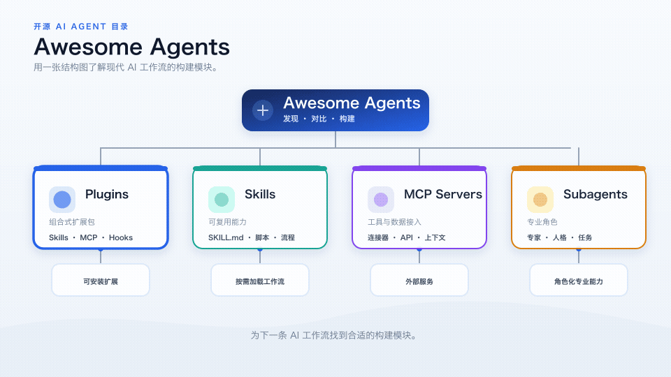

<!-- AUTO-GENERATED FILE. DO NOT EDIT DIRECTLY. Run `npm run build` instead. -->

# Awesome Agent Extensions

> 精选跨平台 Awesome Claude Code Plugins、AI Agent Skills、MCP Servers、Subagents 与扩展管理工具（支持 Claude Code、Codex、Cursor、Gemini CLI、OpenCode、Antigravity 等），内置基于 [NVIDIA/SkillSpector](https://github.com/NVIDIA/SkillSpector) 的自动化安全评分（满分 100）。

[English](README.md) | **简体中文** | [日本語](README.ja.md)

### Awesome Claude Code Plugins

Claude Code 插件是可安装的扩展包，可将 Skills、斜杠命令、Subagents、Hooks、MCP 服务及完整工作流组合在一起。适合需要复用和分发一套 Agent 工作流的场景。

浏览 [全部插件 (370)](docs/plugins.zh.md)，使用 `/plugin install <owner>/<repo>` 安装单个插件，或使用 `/plugin marketplace add <owner>/<repo>` 添加插件市场。

## 快速入口

- [Plugins（复合插件） (370)](docs/plugins.zh.md) · [Skills（技能包） (1039)](docs/skills.zh.md) · [MCP / Connectors (138)](docs/mcp.zh.md) · [Subagents（子代理） (65)](docs/subagents.zh.md) · [扩展管理工具 (135)](docs/tools.zh.md) · [按工具浏览](docs/by-agent.zh.md) · [最佳实践 (51)](docs/guides.zh.md)

常见工具插件安装速查

- **Claude Code Plugin**: `/plugin install <owner>/<repo>` 或 `/plugin marketplace add <owner>/<repo>`
- **跨端 Agent Skills**: `npx skills add <owner>/<repo>`
- **MCP Server**: 按各项目文档配置到对应 Agent 的 MCP 设置（如 `mcpServers` JSON）

## 支持的 Agent 工具

[通用](https://agentskills.io) · [Claude Code](https://docs.anthropic.com/en/docs/claude-code) · [Codex](https://github.com/openai/codex) · [Cursor](https://cursor.com) · [Gemini CLI](https://github.com/google-gemini/gemini-cli) · [OpenCode](https://opencode.ai) · [Antigravity](https://antigravity.google) · [GitHub Copilot](https://github.com/features/copilot) · [Windsurf](https://windsurf.com) · [DeepSeek Harness](https://github.com/awesome-dsh-plugin/awesome-dsh-plugin) · [Kiro](https://kiro.dev) · [Cline](https://cline.bot) · [Pi](https://pi.dev)

### 🛡️ NVIDIA/SkillSpector 安全评分（满分 100）

以上 Agent 生态收录的 **Skills、Plugins、MCP 与 Subagents** 均由 NVIDIA 官方开源安全扫描器 [NVIDIA/SkillSpector](https://github.com/NVIDIA/SkillSpector) 自动进行静态安全扫描（检测提示词注入、数据外泄、危险命令执行、供应链漏洞等），并换算为 **0–100 安全分**（越高越安全）：

- **评分标准**：🟢 **80–100** 安全（Safe） · 🟡 **50–79** 需留意（Caution） · 🔴 **0–49** 高风险（Do Not Install） · `—` 待扫描或不适用
- **零人工干预、杜绝刷分**：分数仅由官方 [GitHub Actions 工作流](.github/workflows/security-scan.yml) 自动生成，CI 强制拦截任何试图在 PR 中手填或篡改分数的提交。
- **持续复检、公开可查**：新增条目合入即扫、上游有新提交自动复检，所有评分明细与扫描时间均公开存档于 [`security/`](security/)，安装前可随时核验。

## AI Agent 最佳实践（Best Practices for AI Agents）

- **[通用 AI Agent 最佳实践](docs/guides.zh.md#通用-ai-agent-最佳实践)**：[Agent Skills Overview](https://agentskills.io/home) · [Agent Skills Quickstart](https://agentskills.io/skill-creation/quickstart) · [Agent Skills Specification](https://agentskills.io/specification) · [全部 4 篇](docs/guides.zh.md#通用-ai-agent-最佳实践)
- **[Claude Code 最佳实践](docs/guides.zh.md#claude-code-最佳实践)**：[Claude Code Best Practices (Anthropic Official)](https://www.anthropic.com/engineering/claude-code-best-practices) · [Claude Code Guide](https://github.com/zebbern/claude-code-guide) · [Claude Code Quickstart (Anthropic Official)](https://code.claude.com/docs/en/quickstart) · [全部 5 篇](docs/guides.zh.md#claude-code-最佳实践)
- **[Codex 最佳实践](docs/guides.zh.md#codex-最佳实践)**：[Codex CLI (OpenAI Official)](https://learn.chatgpt.com/docs/codex/cli) · [Codex IDE Extension (OpenAI Official)](https://learn.chatgpt.com/docs/codex/ide) · [Codex Best Practices (OpenAI Official)](https://learn.chatgpt.com/guides/best-practices) · [全部 4 篇](docs/guides.zh.md#codex-最佳实践)
- **[Cursor 最佳实践](docs/guides.zh.md#cursor-最佳实践)**：[Cursor Quickstart (Cursor Official)](https://cursor.com/docs/get-started/quickstart) · [Cursor Agent Overview (Cursor Official)](https://cursor.com/docs/agent/overview) · [Cursor Rules (Cursor Official)](https://cursor.com/docs/rules) · [全部 4 篇](docs/guides.zh.md#cursor-最佳实践)
- **[Gemini CLI 最佳实践](docs/guides.zh.md#gemini-cli-最佳实践)**：[Get Started with Gemini CLI (Google Official)](https://geminicli.com/docs/get-started/) · [Provide Context with GEMINI.md Files (Google Official)](https://geminicli.com/docs/cli/gemini-md/) · [Manage Context and Memory (Google Official)](https://geminicli.com/docs/cli/tutorials/memory-management/)
- **[OpenCode 最佳实践](docs/guides.zh.md#opencode-最佳实践)**：[OpenCode Intro (OpenCode Official)](https://opencode.ai/docs/) · [OpenCode CLI Intro (OpenCode Official)](https://opencode.ai/docs/cli/) · [OpenCode Instructions (OpenCode Official)](https://opencode.ai/docs/instructions/)
- **[Antigravity 最佳实践](docs/guides.zh.md#antigravity-最佳实践)**：[Antigravity Getting Started (Google Official)](https://antigravity.google/docs/getting-started/) · [Antigravity CLI Best Practices (Google Official)](https://antigravity.google/docs/cli/best-practices/) · [Antigravity Rules (Google Official)](https://antigravity.google/docs/rules/) · [全部 4 篇](docs/guides.zh.md#antigravity-最佳实践)
- **[GitHub Copilot 最佳实践](docs/guides.zh.md#github-copilot-最佳实践)**：[Quickstart for Using GitHub Copilot in Your IDE (GitHub Official)](https://docs.github.com/en/copilot/get-started/quickstart-for-using-github-copilot-in-your-ide) · [Best Practices for Using GitHub Copilot (GitHub Official)](https://docs.github.com/en/copilot/get-started/best-practices) · [Get Started with Copilot Agents on GitHub (GitHub Official)](https://docs.github.com/en/copilot/how-tos/copilot-on-github/use-copilot-agents/overview) · [全部 4 篇](docs/guides.zh.md#github-copilot-最佳实践)
- **[Windsurf 最佳实践](docs/guides.zh.md#windsurf-最佳实践)**：[Devin Desktop Getting Started (Official)](https://docs.devin.ai/desktop/getting-started) · [Devin Desktop FAQ (Official)](https://docs.devin.ai/desktop/devin-desktop-faq) · [Devin Local Overview (Official)](https://docs.devin.ai/desktop/devin-local/overview) · [全部 4 篇](docs/guides.zh.md#windsurf-最佳实践)
- **[DeepSeek Harness 最佳实践](docs/guides.zh.md#deepseek-harness-最佳实践)**：[DeepSeek Harness Web UI Quickstart (Official)](https://deepseek-harness.github.io/deepseek-harness/en/guide/quickstart) · [DeepSeek Harness README (Official)](https://github.com/deepseek-ai/deepseek-harness) · [Your First Plugin (Official)](https://deepseek-harness.github.io/deepseek-harness/en/develop/basic/)
- **[Kiro 最佳实践](docs/guides.zh.md#kiro-最佳实践)**：[Kiro Installation (Official)](https://kiro.dev/docs/getting-started/installation/) · [Your First Project (Official)](https://kiro.dev/docs/getting-started/first-project/) · [Kiro Steering (Official)](https://kiro.dev/docs/steering/) · [全部 5 篇](docs/guides.zh.md#kiro-最佳实践)
- **[Cline 最佳实践](docs/guides.zh.md#cline-最佳实践)**：[Installing Cline (Official)](https://docs.cline.bot/getting-started/installing-cline) · [Using Cline in the IDE (Official)](https://docs.cline.bot/usage/ide) · [Cline Skills (Official)](https://docs.cline.bot/customization/skills) · [全部 4 篇](docs/guides.zh.md#cline-最佳实践)
- **[Pi 最佳实践](docs/guides.zh.md#pi-最佳实践)**：[Pi Quickstart (Official)](https://docs.pi.dev/latest/quickstart) · [Agent Skills (Official)](https://docs.pi.dev/latest/skills) · [MCP Servers (Official)](https://docs.pi.dev/latest/mcp) · [全部 4 篇](docs/guides.zh.md#pi-最佳实践)

## 按场景目录

- [官方与精选 (193)](#官方与精选)
- [编码与工程 (193)](#编码与工程) — 代码开发、重构、测试、调试、代码审查与 Git 工作流。
- [前端与设计 (163)](#前端与设计) — UI 开发、设计系统、浏览器自动化、视觉审查与 Figma 集成。
- [云与运维 (49)](#云与运维) — 部署、容器、可观测性、数据库与云平台集成。
- [编排与多代理协作 (171)](#编排与多代理协作) — 多 Agent 协同、规划流水线、记忆层与工作流编排。
- [数据、研究与知识 (148)](#数据研究与知识) — 联网检索、文档处理、数据分析、学术研究与知识库。
- [效率与协作 (169)](#效率与协作) — 文档、项目管理、日历、即时通讯与日常办公协作。
- [内容与营销 (246)](#内容与营销) — 写作、SEO、社媒发布、音视频制作与增长营销。
- [安全与合规 (45)](#安全与合规) — 漏洞扫描、敏感信息检测、安全护栏与合规审计。
- [插件市场与开发工具 (53)](#插件市场与开发工具) — 插件市场、技能聚合站、跨端安装器与插件开发工具。

## 官方与精选

| 名称 | 类型 | 简介 | 兼容工具 | 安全分 | 活跃度 |
| --- | --- | --- | --- | --- | --- |
| **[Anthropic Agent Skills](https://github.com/anthropics/skills)** `官方` | `Skill` | Anthropic 官方维护的 Agent Skills 集合，覆盖文档制作（docx/pdf/pptx）、前端设计与 Skill 编写参考。 `npx skills add anthropics/skills` | `通用` `Claude Code` | — | ⭐ 201.7k 2026-11-16 |
| **[MCP Reference Servers](https://github.com/modelcontextprotocol/servers)** `官方` | `MCP` | Model Context Protocol 官方参考服务器合集，提供文件系统、Git、数据库与网页接入等标准集成范例。 | `通用` | — | ⭐ 92.3k 2026-11-27 |
| **[Context7 MCP](https://github.com/upstash/context7)** `官方` | `MCP` | Upstash 官方 Context7 MCP 服务器，实时拉取最新、按版本匹配的开源库文档与代码示例并注入 Agent 上下文。 `npx -y @upstash/context7-mcp` | `通用` | — | ⭐ 65.6k 2026-11-28 |
| **[Chrome DevTools MCP](https://github.com/ChromeDevTools/chrome-devtools-mcp)** `官方` | `MCP` | Chrome DevTools 官方 MCP 服务器，让编码 Agent 直接操控、调试、性能分析与审查 Chrome 浏览器页面。 `npx -y chrome-devtools-mcp@latest` | `通用` | — | ⭐ 59.7k 2026-11-27 |
| **[Claude Code Official Plugins](https://github.com/anthropics/claude-plugins-official)** `官方` | `Plugin` | Anthropic 官方维护的 Claude Code 插件市场与目录，提供官方工作流插件、子代理、技能、钩子及合作方 MCP 集成。 `/plugin marketplace add anthropics/claude-plugins-official` | `Claude Code` | — | ⭐ 48.5k 2026-11-28 |
| **[Playwright MCP](https://github.com/microsoft/playwright-mcp)** `官方` | `MCP` | 微软官方 Playwright MCP 服务器，让 Agent 通过结构化无障碍树直接操控浏览器完成测试与网页自动化。 `npx @playwright/mcp@latest` | `通用` | 🔴 0/100 | ⭐ 40.2k 2026-11-27 |
| **[OpenAI Skills Catalog](https://github.com/openai/skills)** `官方` | `Skill` | OpenAI 官方维护的 Agent Skills 目录，为 Codex 及遵循开放标准的 Agent 提供精选可复用技能。 | `Codex` `通用` | — | ⭐ 29.2k 2026-10-28 |
| **[FastMCP](https://github.com/PrefectHQ/fastmcp)** `官方` | `工具` | Python 生态主流 MCP 开发框架，用于快速构建生产级 Model Context Protocol 服务器与客户端。 | `通用` | — | ⭐ 28.8k 2026-11-28 |
| **[Google Agent Skills](https://github.com/google/skills)** `官方` | `Skill` | Google 官方 Agent Skills 仓库，覆盖 Google Cloud 与各类 Google 开发者技术栈的标准技能。 | `通用` `Gemini CLI` `Claude Code` | — | ⭐ 24.9k 2026-11-27 |
| **[MarkItDown](https://github.com/microsoft/markitdown)** `官方` | `MCP` | 微软官方文件转 Markdown 工具及 MCP 服务，支持将 PDF、Office 文档、图片、音频等转换为适合大模型处理的 Markdown。 | `通用` | — | ⭐ 198.8k 2026-11-07 |
| **[shadcn/ui Skill](https://github.com/shadcn-ui/ui)** `官方` | `Skill` | shadcn/ui 官方仓库内置 Agent 技能与上下文规范，辅助管理组件库、主题与现代 React 设计系统。 | `通用` `Claude Code` | — | ⭐ 129.3k 2026-11-27 |
| **[Hyperframes](https://github.com/heygen-com/hyperframes)** `官方` | `Plugin` | HeyGen 官方开源的 AI 视频编辑插件与 MCP 工具集，支持用 HTML 编写动效并渲染输出 MP4。 | `Claude Code` `Codex` `Cursor` `Gemini CLI` | — | ⭐ 91.7k 2026-11-28 |
| **[Cloudflare Security Audit Skill](https://github.com/cloudflare/security-audit-skill)** `官方` | `Skill` | Cloudflare 官方出品的多阶段安全审计技能，可生成经独立验证的机器可读漏洞报告。 | `通用` | 🔴 0/100 | ⭐ 79.4k 2026-09-14 |
| **[Open Code Review](https://github.com/alibaba/open-code-review)** `官方` | `工具` | 阿里巴巴开源的混合架构代码审查工具，结合确定性规则流水线与大模型 Agent 实现行级精准评审。 | `通用` | — | ⭐ 57.0k 2026-11-26 |
| **[Obsidian Skills](https://github.com/obsidianmd/obsidian-skills)** `官方` | `Skill` | Obsidian 官方 Agent 技能包，让 AI 熟练操作 Obsidian 笔记库、Markdown、Bases 与 JSON Canvas。 | `Claude Code` `Codex` `Cursor` `OpenCode` | 🔴 32/100 | ⭐ 54.5k 2026-11-26 |
| **[Agent Browser](https://github.com/vercel-labs/agent-browser)** `官方` | `工具` | Vercel 官方推出的面向 AI Agent 的无头浏览器自动化命令行工具与配套技能。 | `通用` | — | ⭐ 54.4k 2026-11-27 |
| **[Vercel Skills CLI](https://github.com/vercel-labs/skills)** `官方` | `工具` | Vercel 官方开源的跨端 Agent 技能管理工具（npx skills），用于检索、安装与管理技能包。 | `通用` | — | ⭐ 41.2k 2026-11-27 |
| **[Vercel Agent Skills](https://github.com/vercel-labs/agent-skills)** `官方` | `Skill` | Vercel 官方维护的 Agent 技能集合，涵盖 React 最佳实践、Web 设计规范与部署流程。 | `通用` | — | ⭐ 35.1k 2026-11-20 |
| **[Video Use](https://github.com/browser-use/video-use)** `官方` | `Skill` | Browser Use 官方推出的 Agent 视频编辑技能，赋能编码 Agent 以程序化方式剪辑与处理视频。 | `通用` | 🔴 0/100 | ⭐ 31.7k 2026-10-08 |
| **[DESIGN.md](https://github.com/google-labs-code/design.md)** `官方` | `工具` | Google Labs 官方推出的 DESIGN.md 格式规范与配套工具，让编码 Agent 持久理解项目设计系统。 | `通用` | — | ⭐ 29.2k 2026-11-18 |

_当前仅展示前 20 条（共 193 条）。完整列表请浏览 [Plugins](docs/plugins.zh.md) · [Skills](docs/skills.zh.md) · [MCP](docs/mcp.zh.md) · [Subagents](docs/subagents.zh.md) · [工具](docs/tools.zh.md) · [按工具浏览](docs/by-agent.zh.md)。_

## 编码与工程

_代码开发、重构、测试、调试、代码审查与 Git 工作流。_

| 名称 | 类型 | 简介 | 兼容工具 | 安全分 | 活跃度 |
| --- | --- | --- | --- | --- | --- |
| **[Context7 MCP](https://github.com/upstash/context7)** `官方` | `MCP` | Upstash 官方 Context7 MCP 服务器，实时拉取最新、按版本匹配的开源库文档与代码示例并注入 Agent 上下文。 `npx -y @upstash/context7-mcp` | `通用` | — | ⭐ 65.6k 2026-11-28 |
| **[OpenAI Skills Catalog](https://github.com/openai/skills)** `官方` | `Skill` | OpenAI 官方维护的 Agent Skills 目录，为 Codex 及遵循开放标准的 Agent 提供精选可复用技能。 | `Codex` `通用` | — | ⭐ 29.2k 2026-10-28 |
| **[Open Code Review](https://github.com/alibaba/open-code-review)** `官方` | `工具` | 阿里巴巴开源的混合架构代码审查工具，结合确定性规则流水线与大模型 Agent 实现行级精准评审。 | `通用` | — | ⭐ 57.0k 2026-11-26 |
| **[Agent Browser](https://github.com/vercel-labs/agent-browser)** `官方` | `工具` | Vercel 官方推出的面向 AI Agent 的无头浏览器自动化命令行工具与配套技能。 | `通用` | — | ⭐ 54.4k 2026-11-27 |
| **[Elephant Goldfish Model](https://github.com/google/elephant-goldfish-model)** `官方` | `Plugin` | Google 官方开源的规范驱动开发插件，支持借助编码 Agent 进行软件架构设计与结构化评审。 | `Claude Code` `Codex` `Cursor` `Gemini CLI` `+3` | — | ⭐ 23.5k 2026-11-25 |
| **[Browser Harness](https://github.com/browser-use/browser-harness)** `官方` | `工具` | Browser Use 官方浏览器控制桥接工具，让编码 Agent 直接操作你本地已登录的 Chrome 浏览器。 | `Claude Code` `Codex` `Cursor` | — | ⭐ 19.3k 2026-11-28 |
| **[MiniMax Agent Skills](https://github.com/MiniMax-AI/skills)** `官方` | `Skill` | MiniMax 官方维护的 AI Agent 技能与多端插件集合，适用于主流编码与效率工作流。 | `Claude Code` `Codex` `Cursor` `OpenCode` | — | ⭐ 13.9k 2026-11-10 |
| **[Android Agent Skills](https://github.com/android/skills)** `官方` | `Skill` | Android 官方维护的 Agent 技能集合，覆盖 Jetpack Compose、构建系统、测试、性能优化、安全及多端适配。 | `通用` `Claude Code` `Codex` | — | ⭐ 10.8k 2026-11-23 |
| **[HumanLayer Skills](https://github.com/humanlayer/skills)** `官方` | `Skill` | HumanLayer 官方开源的 Agent 技能与插件集，覆盖代码库调研、方案规划与工程实现工作流。 | `Claude Code` `通用` | — | ⭐ 6.0k 2026-11-01 |
| **[Expo Agent Skills](https://github.com/expo/skills)** `官方` | `Skill` | Expo 官方维护的 AI Agent 技能集合，助力构建、配置并使用 EAS 发布 React Native 移动应用。 | `通用` `Claude Code` | — | ⭐ 4.3k 2026-11-27 |
| **[Laravel Boost](https://github.com/laravel/boost)** `官方` | `MCP` | Laravel 官方 MCP 服务器，为 AI 辅助本地 Laravel 开发提供框架上下文与专用工具。 | `通用` | — | ⭐ 3.7k 2026-11-28 |
| **[Vue 3 Agent Skills](https://github.com/vuejs-ai/skills)** `官方` | `Skill` | Vue 官方组织维护的 Vue 3 开发技能集，为 AI Agent 提供规范的组合式 API 与组件开发指导。 | `通用` | — | ⭐ 3.4k 2026-10-23 |
| **[Stripe AI](https://github.com/stripe/ai)** `官方` | `Plugin` | Stripe 官方 AI 开发套件，集成 Agent 工具包、MCP 服务、多端插件与技能，助力构建支付与商业化工作流。 | `通用` | — | ⭐ 2.1k 2026-11-25 |
| **[Callstack React Native Agent Skills](https://github.com/callstackincubator/agent-skills)** `官方` | `Skill` | Callstack 官方推出的 React Native Agent 技能集，涵盖移动端架构优化、性能调优与工程最佳实践。 | `通用` | — | ⭐ 1.7k 2026-10-08 |
| **[ast-grep Agent Skill](https://github.com/ast-grep/agent-skill)** `官方` | `Skill` | ast-grep 官方 Agent 技能，用于基于抽象语法树的结构化代码检索与重构。 | `通用` | — | ⭐ 914 2026-11-04 |
| **[MiniMax mcode-stack](https://github.com/MiniMax-AI/mcode-stack)** `官方` | `Skill` | MiniMax Code 团队开源的内部工程工作流与 Agent Skills 技能栈。 | `Claude Code` `通用` | — | ⭐ 748 2026-11-11 |
| **[Code Graph MCP](https://github.com/diffbot/mcp-code-graph)** `官方` | `MCP` | 用于代码库知识图谱分析、依赖追踪与架构可视化的 MCP 服务器。 | `通用` | — | ⭐ 401 2025-11-25 |
| **[Han (Test Double)](https://github.com/testdouble/han)** `官方` | `Plugin` | Test Double 出品的独立产品工程师与小团队专属插件，覆盖代码审查、问题排查与文档维护。 | `Claude Code` | — | ⭐ 360 2026-11-12 |
| **[Resend Agent Skills](https://github.com/resend/resend-skills)** `官方` | `Skill` | Resend 官方 Agent 技能集，辅助智能体集成邮件发送与接收功能。 | `通用` | — | ⭐ 220 2026-11-27 |
| **[MATLAB & Simulink Agent Skills](https://github.com/matlab/agent-skills-playground)** `官方` | `Skill` | MathWorks 官方开源的 MATLAB 与 Simulink 工程建模 Agent Skills 技能示例库。 | `Claude Code` `通用` | — | ⭐ 206 2026-10-14 |

_当前仅展示前 20 条（共 193 条）。完整列表请浏览 [Plugins](docs/plugins.zh.md) · [Skills](docs/skills.zh.md) · [MCP](docs/mcp.zh.md) · [Subagents](docs/subagents.zh.md) · [工具](docs/tools.zh.md) · [按工具浏览](docs/by-agent.zh.md)。_

## 前端与设计

_UI 开发、设计系统、浏览器自动化、视觉审查与 Figma 集成。_

| 名称 | 类型 | 简介 | 兼容工具 | 安全分 | 活跃度 |
| --- | --- | --- | --- | --- | --- |
| **[Chrome DevTools MCP](https://github.com/ChromeDevTools/chrome-devtools-mcp)** `官方` | `MCP` | Chrome DevTools 官方 MCP 服务器，让编码 Agent 直接操控、调试、性能分析与审查 Chrome 浏览器页面。 `npx -y chrome-devtools-mcp@latest` | `通用` | — | ⭐ 59.7k 2026-11-27 |
| **[Playwright MCP](https://github.com/microsoft/playwright-mcp)** `官方` | `MCP` | 微软官方 Playwright MCP 服务器，让 Agent 通过结构化无障碍树直接操控浏览器完成测试与网页自动化。 `npx @playwright/mcp@latest` | `通用` | 🔴 0/100 | ⭐ 40.2k 2026-11-27 |
| **[shadcn/ui Skill](https://github.com/shadcn-ui/ui)** `官方` | `Skill` | shadcn/ui 官方仓库内置 Agent 技能与上下文规范，辅助管理组件库、主题与现代 React 设计系统。 | `通用` `Claude Code` | — | ⭐ 129.3k 2026-11-27 |
| **[Vercel Agent Skills](https://github.com/vercel-labs/agent-skills)** `官方` | `Skill` | Vercel 官方维护的 Agent 技能集合，涵盖 React 最佳实践、Web 设计规范与部署流程。 | `通用` | — | ⭐ 35.1k 2026-11-20 |
| **[DESIGN.md](https://github.com/google-labs-code/design.md)** `官方` | `工具` | Google Labs 官方推出的 DESIGN.md 格式规范与配套工具，让编码 Agent 持久理解项目设计系统。 | `通用` | — | ⭐ 29.2k 2026-11-18 |
| **[Modern Web Guidance](https://github.com/GoogleChrome/modern-web-guidance)** `官方` | `Skill` | Google Chrome 官方维护的现代 Web 开发指南技能集，让编码 Agent 紧跟最新 Web 标准与最佳实践。 | `Claude Code` `Codex` `Cursor` `Gemini CLI` | — | ⭐ 27.2k 2026-11-23 |
| **[GSAP Skills](https://github.com/greensock/gsap-skills)** `官方` | `Skill` | GSAP 官方推出的 AI 技能集，指导编码 Agent 正确使用 GreenSock 动画模式与各类插件。 | `Claude Code` `Cursor` `Gemini CLI` | 🔴 2/100 | ⭐ 19.2k 2026-07-29 |
| **[Playwright CLI](https://github.com/microsoft/playwright-cli)** `官方` | `工具` | Playwright 官方命令行工具与 Agent 技能，支持录制浏览器操作、生成测试代码、检查选择器与截图。 | `通用` `Claude Code` | — | ⭐ 15.5k 2026-11-24 |
| **[e2e Agent Skill](https://github.com/e2e-inc/e2e)** `官方` | `Skill` | e2e 智能端到端测试框架官方技能，支持在 Playwright 浏览器及 iOS/Android 设备上编写、运行与调试测试。 | `通用` `Claude Code` | — | ⭐ 14.5k 2026-11-28 |
| **[Google Stitch Skills](https://github.com/google-labs-code/stitch-skills)** `官方` | `Skill` | Google Labs 官方提供的开放标准 Agent Skills 库，配合 Stitch MCP 服务完成界面设计与前端开发工作流。 | `通用` `Antigravity` `Gemini CLI` `Claude Code` `+1` | 🔴 0/100 | ⭐ 13.7k 2026-11-28 |
| **[Browser MCP](https://github.com/BrowserMCP/mcp)** `官方` | `MCP` | 结合浏览器插件的 MCP 服务器，让 AI Agent 复用本地浏览器登录态完成网页操作与自动化任务。 `npx -y @browsermcp/mcp@latest` | `通用` | — | ⭐ 7.4k 2026-11-12 |
| **[BrowserAct Skills](https://github.com/browser-act/skills)** `官方` | `Skill` | BrowserAct 官方浏览器自动化技能集，支持复杂网页交互、数据采集与任务接管。 | `通用` `Claude Code` | — | ⭐ 6.4k 2026-11-04 |
| **[Diffusion Studio Lottie](https://github.com/diffusionstudio/lottie)** `官方` | `Skill` | Diffusion Studio 官方技能，支持使用 Claude Code 或 Codex 生成并预览生产级 Lottie 矢量动画。 | `Claude Code` `Codex` `通用` | — | ⭐ 5.8k 2026-07-25 |
| **[LottieFiles Motion Design Skill](https://github.com/LottieFiles/motion-design-skill)** `官方` | `Skill` | LottieFiles 官方动效设计技能，将时间节奏、缓动曲线、编排及经典动画原则应用于 UI 动效。 | `通用` | — | ⭐ 3.8k 2026-11-23 |
| **[Angular Official Skills](https://github.com/angular/skills)** `官方` | `Skill` | Angular 官方 Agent 技能集，涵盖新项目搭建与现代 Angular 开发最佳实践。 | `通用` | — | ⭐ 738 2026-11-25 |
| **[Sleek Design Agent Skills](https://github.com/sleekdotdesign/agent-skills)** `官方` | `Skill` | Sleek 官方 Agent 技能，通过 REST API 创建和编辑移动应用界面设计并导出截图与 HTML。 | `通用` | — | ⭐ 604 2026-10-05 |
| **[Refero Design Research Skill](https://github.com/referodesign/refero_skill)** `官方` | `Plugin` | Refero 官方调研优先 UI 设计插件，通过 MCP 接入 15 万+ 真实应用界面与交互流程参考。 | `Claude Code` `Codex` `Cursor` `通用` | — | ⭐ 370 2026-11-25 |
| **[Svelte Official MCP](https://github.com/sveltejs/ai-tools)** `官方` | `MCP` | Svelte 官方 MCP 服务器与 AI 开发工具集，助力 Svelte 与 SvelteKit 应用开发。 | `通用` | — | ⭐ 347 2026-11-28 |
| **[CesiumJS Agent Skills](https://github.com/CesiumGS/cesiumjs-skills)** `官方` | `Plugin` | Cesium 官方开源的 3D 地理空间与 CesiumJS Web 开发 Agent 技能插件。 | `Claude Code` `Codex` `GitHub Copilot` `通用` | — | ⭐ 198 2026-09-14 |
| **[UX Pilot Frontend Design Skill](https://github.com/uxpilot-ai/frontend-design-skill)** `官方` | `Skill` | UX Pilot 官方前端设计技能，先在可视化画布完成界面设计再精准还原为前端代码。 | `Claude Code` `Codex` `Cursor` `通用` | — | ⭐ 197 2026-11-25 |

_当前仅展示前 20 条（共 163 条）。完整列表请浏览 [Plugins](docs/plugins.zh.md) · [Skills](docs/skills.zh.md) · [MCP](docs/mcp.zh.md) · [Subagents](docs/subagents.zh.md) · [工具](docs/tools.zh.md) · [按工具浏览](docs/by-agent.zh.md)。_

## 云与运维

_部署、容器、可观测性、数据库与云平台集成。_

| 名称 | 类型 | 简介 | 兼容工具 | 安全分 | 活跃度 |
| --- | --- | --- | --- | --- | --- |
| **[Google Agent Skills](https://github.com/google/skills)** `官方` | `Skill` | Google 官方 Agent Skills 仓库，覆盖 Google Cloud 与各类 Google 开发者技术栈的标准技能。 | `通用` `Gemini CLI` `Claude Code` | — | ⭐ 24.9k 2026-11-27 |
| **[Google Agents CLI](https://github.com/google/agents-cli)** `官方` | `工具` | Google 官方推出的命令行工具与技能集，帮助编码助手基于 ADK 在 Google Cloud 上构建、评估与部署 AI Agent。 | `通用` `Claude Code` `Gemini CLI` | — | ⭐ 6.4k 2026-11-24 |
| **[DBHub MCP](https://github.com/bytebase/dbhub)** `官方` | `MCP` | Bytebase 开源的通用数据库 MCP 服务器，节省上下文 Token，支持 PostgreSQL、MySQL、SQL Server、Oracle 与 SQLite。 `npx -y @bytebase/dbhub` | `通用` | — | ⭐ 4.0k 2026-11-25 |
| **[Cloudflare Skills](https://github.com/cloudflare/skills)** `官方` | `Skill` | Cloudflare 官方 Agent 技能集，指导 AI 助手基于 Cloudflare Workers 及开发者平台进行构建与部署。 | `通用` | — | ⭐ 3.5k 2026-11-25 |
| **[Supabase Agent Skills](https://github.com/supabase/agent-skills)** `官方` | `Skill` | Supabase 官方 Agent 技能集，帮助 AI 编程助手遵循 Postgres、认证、RLS 与边缘函数最佳实践。 | `通用` | — | ⭐ 3.1k 2026-11-12 |
| **[Supabase MCP](https://github.com/supabase/mcp)** `官方` | `MCP` | Supabase 官方 MCP 服务器，让 Agent 直接查询数据库、管理表结构迁移、Edge Functions 与项目日志。 `npx -y @supabase/mcp-server-supabase` | `通用` | — | ⭐ 3.0k 2026-11-28 |
| **[PostgreSQL AI Guide](https://github.com/timescale/pg-aiguide)** `官方` | `Plugin` | Timescale 官方 PostgreSQL MCP 与 Claude 插件，提供权威 Postgres 技能、版本文档与查询最佳实践。 | `Claude Code` `通用` | — | ⭐ 1.9k 2026-11-26 |
| **[Terraform MCP Server](https://github.com/hashicorp/terraform-mcp-server)** `官方` | `MCP` | 在 MCP 客户端中查询 Terraform Registry 的提供程序和模块，并管理 HCP Terraform 工作区。 `codex mcp add terraform -- docker run -i --rm hashicorp/terraform-mcp-server` | `Claude Code` `Codex` `Cursor` `Gemini CLI` `+1` | — | ⭐ 1.6k 2026-11-25 |
| **[MongoDB MCP Server](https://github.com/mongodb-js/mongodb-mcp-server)** `官方` | `MCP` | MongoDB 官方 MCP 服务器，支持 AI Agent 查询集合、分析数据结构并管理 MongoDB Atlas 集群。 `npx -y mongodb-mcp-server` | `通用` | — | ⭐ 1.2k 2026-11-27 |
| **[Sentry Agentic Toolkit](https://github.com/getsentry/toolkit)** `官方` | `Plugin` | Sentry 官方 Agent 工具套件，融合 MCP 与技能用于排查线上报错、堆栈追踪与回归定位。 | `通用` `Claude Code` | — | ⭐ 976 2026-11-28 |
| **[HashiCorp Agent Skills](https://github.com/hashicorp/agent-skills)** `官方` | `Skill` | HashiCorp 官方维护的 Agent 技能集，面向 Terraform 工作流与基础设施自动化。 | `Claude Code` `通用` | — | ⭐ 942 2026-11-04 |
| **[Redis MCP Server](https://github.com/redis/mcp-redis)** `官方` | `MCP` | Redis 官方 MCP 服务器，为 AI Agent 提供自然语言查询、缓存管理与 Redis 数据检视接口。 | `通用` | — | ⭐ 644 2026-11-27 |
| **[Cloud Run MCP](https://github.com/GoogleCloudPlatform/cloud-run-mcp)** `官方` | `MCP` | Google Cloud 官方 Cloud Run MCP 服务器，支持 AI Agent 一键构建、部署并管理云端容器服务。 `npx -y @google-cloud/cloud-run-mcp` | `通用` | — | ⭐ 641 2026-11-27 |
| **[Firebase Agent Skills](https://github.com/firebase/agent-skills)** `官方` | `Skill` | Firebase 官方 Agent 技能集，辅助智能体完成 Firebase 后端构建、配置与部署。 | `通用` | — | ⭐ 533 2026-11-09 |
| **[Railway Agent Skills](https://github.com/railwayapp/railway-skills)** `官方` | `Skill` | Railway 官方 Agent 技能包，支持创建服务、管理环境变量、查看日志与一键部署云端应用。 | `通用` `Claude Code` | — | ⭐ 346 2026-11-27 |
| **[Qdrant Skills](https://github.com/qdrant/skills)** `官方` | `Skill` | Qdrant 官方 Agent 技能包，涵盖向量检索操作、性能调优、部署升级与 SDK 开发。 | `Claude Code` `通用` | — | ⭐ 270 2026-11-26 |
| **[TraxAgent Budget Governance](https://github.com/ccarter01011/traxagent-claude-plugin)** `官方` | `Plugin` | 只读 AI 预算治理与成本分析插件，快速定位 Token 开销来源并给出具体降本建议。 | `Claude Code` `Cursor` `通用` | — | ⭐ 172 2026-11-24 |
| **[Pydantic Logfire MCP](https://github.com/pydantic/logfire-mcp)** `官方` | `MCP` | Pydantic 官方 Logfire MCP 服务器，支持 AI Agent 查询 OpenTelemetry 链路追踪、异常日志与线上指标。 `uvx logfire-mcp` | `通用` | — | ⭐ 162 2026-07-13 |
| **[JetBrains TeamCity CLI & Skill](https://github.com/JetBrains/teamcity-cli)** `官方` | `Skill` | JetBrains 官方 TeamCity CLI 与 Agent 技能，支持查询 CI 构建日志、代理状态与构建队列。 | `Claude Code` `通用` | — | ⭐ 132 2026-11-25 |
| **[Neo4j Agent Skills](https://github.com/neo4j/agent-skills)** `官方` | `Skill` | Neo4j 官方 Agent 技能包，涵盖 Cypher 查询编写、图数据建模与 Neo4j 应用开发。 | `Claude Code` `Codex` `Gemini CLI` `通用` | — | ⭐ 124 2026-11-27 |

_当前仅展示前 20 条（共 49 条）。完整列表请浏览 [Plugins](docs/plugins.zh.md) · [Skills](docs/skills.zh.md) · [MCP](docs/mcp.zh.md) · [Subagents](docs/subagents.zh.md) · [工具](docs/tools.zh.md) · [按工具浏览](docs/by-agent.zh.md)。_

## 编排与多代理协作

_多 Agent 协同、规划流水线、记忆层与工作流编排。_

| 名称 | 类型 | 简介 | 兼容工具 | 安全分 | 活跃度 |
| --- | --- | --- | --- | --- | --- |
| **[Honcho](https://github.com/plastic-labs/honcho)** `官方` | `工具` | Plastic Labs 官方有状态代理记忆库与 CLI/MCP 工具套件，为多端编码代理提供持续学习与记忆能力。 | `通用` `Claude Code` `Cursor` `DeepSeek Harness` | — | ⭐ 8.3k 2026-11-25 |
| **[MemSearch](https://github.com/zilliztech/memsearch)** `官方` | `Plugin` | Zilliz 官方出品的跨 Agent 持久化统一记忆层插件，结合本地 Markdown 与 Milvus 向量检索。 | `Claude Code` `Codex` `DeepSeek Harness` `通用` | — | ⭐ 3.0k 2026-11-27 |
| **[Claude Brain (Memvid)](https://github.com/memvid/claude-brain)** `官方` | `Plugin` | 基于 Rust 内核的便携式记忆插件，将 Claude Code 长期记忆压缩进单个可 Git 管理的 .mv2 文件。 | `Claude Code` | — | ⭐ 585 2026-01-19 |
| **[ClickHouse Loom](https://github.com/ClickHouse/loom)** `官方` | `Plugin` | ClickHouse 官方开源的符号级代码索引、文档检索与共享长期记忆插件。 | `Claude Code` `通用` | — | ⭐ 248 2026-11-28 |
| **[Corezoid AI Plugin](https://github.com/corezoid/corezoid-ai-plugin)** `官方` | `Plugin` | Corezoid 官方 AI 插件，提供流程编排技能、Schema、模板手册与 MCP 参考。 | `Claude Code` `Codex` | — | ⭐ 74 2026-11-13 |
| **[Superpowers](https://github.com/obra/superpowers)** | `Plugin` | 面向编码 Agent 的结构化工程工作流插件，内置方案设计、严格 TDD、系统化调试与子代理驱动开发。 `/plugin install obra/superpowers` | `Claude Code` `Codex` `Cursor` `OpenCode` | — | ⭐ 328.6k 2026-11-28 |
| **[Oh My ClaudeCode](https://github.com/Yeachan-Heo/oh-my-claudecode)** | `Plugin` | 面向团队协作的 Claude Code 多 Agent 编排插件，整合专业子代理、技能、Hooks 与并行执行工作流。 | `Claude Code` | — | ⭐ 41.1k 2026-11-28 |
| **[Vibe Kanban](https://github.com/BloopAI/vibe-kanban)** | `工具` | 可视化看板编排工具，支持同时调度、监控并评审 Claude Code、Codex 等多个编码 Agent 的并行任务。 | `Claude Code` `Codex` `通用` | — | ⭐ 28.8k 2026-11-28 |
| **[pstack Multi-Harness Plugin](https://github.com/michael-denyer/pstack-claude)** | `Plugin` | 将 Cursor 工程工作流原语移植到 Claude Code、Codex、Copilot、Gemini CLI、OpenCode 与 Antigravity 的跨端插件。 | `Claude Code` `Codex` `GitHub Copilot` `Gemini CLI` `+3` | — | ⭐ 5.0k 2026-11-27 |
| **[Token Optimizer](https://github.com/alexgreensh/token-optimizer)** | `Plugin` | 定位冗余 Token 消耗、优化上下文压缩并防止长会话上下文质量衰减的插件。 | `Claude Code` `Codex` | — | ⭐ 3.2k 2026-11-28 |
| **[LongHorizon Harness](https://github.com/AMAP-ML/LongHorizon-Harness)** | `Plugin` | 面向长周期桌面与命令行任务的 Agent 运行时插件，支持刷新上下文执行、持久化状态校验与独立审计。 | `Claude Code` `Codex` `DeepSeek Harness` | — | ⭐ 1.9k 2026-11-11 |
| **[Everything Claude Code (ECC)](https://github.com/affaan-m/ECC)** | `Plugin` | 集成技能、直觉记忆、安全规范与研究驱动工作流的 Agent 运行框架性能优化套件。 | `Claude Code` `Codex` `OpenCode` `Cursor` `+2` | — | ⭐ 312.1k 2026-11-23 |
| **[Claude Mem](https://github.com/thedotmack/claude-mem)** | `Plugin` | 跨会话持久化记忆插件，自动捕获并压缩 Agent 操作上下文，在后续会话中按需注入。 | `Claude Code` `Codex` `Cursor` `Gemini CLI` `+2` | — | ⭐ 120.3k 2026-11-28 |
| **[Ruflo (Claude Flow)](https://github.com/ruvnet/ruflo)** | `Plugin` | 面向 Claude Code 与 Codex 的多 Agent 蜂群编排平台，集成协同子代理、记忆层、技能系统与 MCP 工具。 | `Claude Code` `Codex` `通用` | — | ⭐ 82.6k 2026-11-28 |
| **[Oh My OpenAgent (OmO)](https://github.com/code-yeongyu/oh-my-openagent)** | `Plugin` | 面向 OpenCode 与主流编码工具的多 Agent 编排插件与运行框架，强化复杂任务协同工作流。 | `OpenCode` `Claude Code` `Codex` `Cursor` `+1` | — | ⭐ 71.2k 2026-11-28 |
| **[Context Mode](https://github.com/mksglu/context-mode)** | `Plugin` | 零遥测本地上下文优化插件，利用沙箱与 SQLite FTS5 检索将冗长工具输出隔离在上下文窗口之外。 | `Claude Code` `Codex` `Gemini CLI` `GitHub Copilot` `+2` | — | ⭐ 34.6k 2026-11-28 |
| **[AgentMemory](https://github.com/rohitg00/agentmemory)** | `Skill` | 跨会话持久化记忆插件与技能套件，支持记忆写入、检索、会话交接、复盘沉淀与隐私清理。 | `通用` `Claude Code` | — | ⭐ 30.6k 2026-11-27 |
| **[Planning with Files](https://github.com/OthmanAdi/planning-with-files)** | `Skill` | 仿 Manus 模式的持久化 Markdown 规划技能，支持长任务断点恢复、防上下文腐化与完成校验。 | `通用` | — | ⭐ 28.3k 2026-11-25 |
| **[n8n MCP](https://github.com/czlonkowski/n8n-mcp)** | `MCP` | 面向 n8n 的 MCP 服务器，支持 AI Agent 检索节点文档、校验参数并构建或运行 n8n 自动化工作流。 `npx -y n8n-mcp` | `通用` | — | ⭐ 23.3k 2026-11-27 |
| **[PUA Skill](https://github.com/tanweai/pua)** | `Skill` | 高强度激励提示技能，驱动 AI Agent 在放弃前穷尽一切排查与解决思路。 | `Claude Code` `通用` | — | ⭐ 19.9k 2026-09-09 |

_当前仅展示前 20 条（共 171 条）。完整列表请浏览 [Plugins](docs/plugins.zh.md) · [Skills](docs/skills.zh.md) · [MCP](docs/mcp.zh.md) · [Subagents](docs/subagents.zh.md) · [工具](docs/tools.zh.md) · [按工具浏览](docs/by-agent.zh.md)。_

## 数据、研究与知识

_联网检索、文档处理、数据分析、学术研究与知识库。_

| 名称 | 类型 | 简介 | 兼容工具 | 安全分 | 活跃度 |
| --- | --- | --- | --- | --- | --- |
| **[MarkItDown](https://github.com/microsoft/markitdown)** `官方` | `MCP` | 微软官方文件转 Markdown 工具及 MCP 服务，支持将 PDF、Office 文档、图片、音频等转换为适合大模型处理的 Markdown。 | `通用` | — | ⭐ 198.8k 2026-11-07 |
| **[Screenpipe](https://github.com/screenpipe/screenpipe)** `官方` | `工具` | 本地优先的屏幕与音频记录引擎，配套技能可检索本地会议、屏幕与界面上下文。 | `Claude Code` `通用` | — | ⭐ 22.6k 2026-11-28 |
| **[Apify MCP Server](https://github.com/apify/apify-mcp-server)** `官方` | `MCP` | Apify 官方 MCP 服务器，让 Agent 直接调用数千个 Apify Actors 完成网页抓取、社媒与电商数据采集。 `npx -y @apify/actors-mcp-server` | `通用` | — | ⭐ 18.2k 2026-11-27 |
| **[Hugging Face Skills](https://github.com/huggingface/skills)** `官方` | `Skill` | 让编码助手查询 Hugging Face Hub 数据集、微调模型并运行模型评估的技能集。 `hf skills add huggingface-datasets` | `Claude Code` `Codex` `Cursor` `Gemini CLI` | — | ⭐ 11.4k 2026-11-26 |
| **[Firecrawl MCP Server](https://github.com/firecrawl/firecrawl-mcp-server)** `官方` | `MCP` | Firecrawl 官方 MCP 服务器，为 AI Agent 提供联网搜索、网页抓取、整站爬取与结构化数据抽取能力。 `npx -y firecrawl-mcp` | `通用` | — | ⭐ 7.9k 2026-11-27 |
| **[Microsoft Learn MCP](https://github.com/MicrosoftDocs/mcp)** `官方` | `MCP` | 微软官方 Learn MCP 服务器与 CLI，为 AI Agent 提供最新的 Microsoft、Azure 与 .NET 官方技术文档检索。 | `通用` | — | ⭐ 2.0k 2026-11-13 |
| **[ktx Analytics Context](https://github.com/Kaelio/ktx)** `官方` | `Skill` | 面向数据分析 Agent 的可执行语义上下文层，确保模型按真实业务口径准确查询分析型数据库。 | `Claude Code` `Codex` `通用` | — | ⭐ 1.6k 2026-11-18 |
| **[Alpaca MCP Server](https://github.com/alpacahq/alpaca-mcp-server)** `官方` | `MCP` | Alpaca 官方 MCP 服务器，支持 AI Agent 获取实时行情数据并操作股票、ETF、期权与加密货币交易接口。 `uvx alpaca-mcp-server` | `通用` | — | ⭐ 1.1k 2026-11-24 |
| **[Oxylabs Agent Skills](https://github.com/oxylabs/agent-skills)** `官方` | `Skill` | Oxylabs 官方 Agent 技能包，支持结构化网页采集、浏览器渲染与实时搜索数据提取。 | `Claude Code` `通用` | — | ⭐ 867 2026-11-27 |
| **[Posit Data Science Skills](https://github.com/posit-dev/skills)** `官方` | `Plugin` | Posit 官方维护的数据科学技能包，面向 R、Python、Quarto 与 Shiny 可复现分析工作流。 | `Claude Code` `通用` | — | ⭐ 576 2026-11-12 |
| **[AntV Chart Visualization Skills](https://github.com/antvis/chart-visualization-skills)** `官方` | `Skill` | AntV 官方数据可视化 Agent 技能集，助力智能体将数据转化为清晰的图表视觉语言。 | `通用` | — | ⭐ 545 2026-09-22 |
| **[Tavily Agent Skills](https://github.com/tavily-ai/skills)** `官方` | `Skill` | Tavily 官方 Agent 技能集，提供实时网页搜索、内容抓取与在线研究能力。 | `通用` | — | ⭐ 497 2026-11-24 |
| **[Apify Awesome Skills](https://github.com/apify/awesome-skills)** `官方` | `Skill` | Apify 官方数据采集技能集，支持抓取 Reddit 帖子、评论、社区及各类网页结构化数据。 | `Claude Code` `通用` | — | ⭐ 305 2026-11-24 |
| **[Firecrawl Claude Plugin](https://github.com/firecrawl/firecrawl-claude-plugin)** `官方` | `Plugin` | Firecrawl 官方 Claude Code 插件，支持实时联网搜索、抓取技术文档与抽取结构化网页数据。 | `Claude Code` | — | ⭐ 272 2026-11-19 |
| **[BibiGPT Video & Podcast Skill](https://github.com/JimmyLv/bibigpt-skill)** `官方` | `Skill` | BibiGPT 官方音视频总结技能与 MCP，支持 YouTube、B 站与小宇宙播客的带时间戳深度摘要。 | `Claude Code` `Cursor` `Codex` `通用` | — | ⭐ 147 2026-11-13 |
| **[Dex Analytics Engineering](https://github.com/exmergo/dex)** `官方` | `Plugin` | 面向数据分析工程的插件，让编程 Agent 自动建模、测试并构建 BigQuery 等数仓分析管线。 | `Claude Code` | — | ⭐ 146 2026-11-28 |
| **[Altimate Data Engineering & dbt Skills](https://github.com/AltimateAI/data-engineering-skills)** `官方` | `Skill` | AltimateAI 官方数据工程技能包，涵盖 dbt 建模、SQL 血缘分析、数据质量测试与数仓优化。 | `Claude Code` `通用` | — | ⭐ 137 2026-10-27 |
| **[InfraNodus Graph Insight Skills](https://github.com/infranodus/skills)** `官方` | `Skill` | InfraNodus 官方文本网络图谱分析技能，通过发现概念盲区提升大模型深度洞察力。 | `Claude Code` `通用` | — | ⭐ 128 2026-11-12 |
| **[Live Tennis API MCP](https://github.com/livetennisapi/livetennisapi-mcp)** `官方` | `MCP` | Live Tennis API 官方 MCP 服务器，为 AI Agent 提供实时网球比分、ATP/WTA 排名与赛事统计数据。 | `通用` | — | ⭐ 125 2026-11-25 |
| **[PostHog Official AI Plugin](https://github.com/PostHog/ai-plugin)** `官方` | `Plugin` | PostHog 官方 AI 编码插件，跨端集成产品数据分析、特性开关与 A/B 实验管理。 | `Claude Code` `Cursor` `Gemini CLI` `Codex` | — | ⭐ 101 2026-11-27 |

_当前仅展示前 20 条（共 148 条）。完整列表请浏览 [Plugins](docs/plugins.zh.md) · [Skills](docs/skills.zh.md) · [MCP](docs/mcp.zh.md) · [Subagents](docs/subagents.zh.md) · [工具](docs/tools.zh.md) · [按工具浏览](docs/by-agent.zh.md)。_

## 效率与协作

_文档、项目管理、日历、即时通讯与日常办公协作。_

| 名称 | 类型 | 简介 | 兼容工具 | 安全分 | 活跃度 |
| --- | --- | --- | --- | --- | --- |
| **[Anthropic Agent Skills](https://github.com/anthropics/skills)** `官方` | `Skill` | Anthropic 官方维护的 Agent Skills 集合，覆盖文档制作（docx/pdf/pptx）、前端设计与 Skill 编写参考。 `npx skills add anthropics/skills` | `通用` `Claude Code` | — | ⭐ 201.7k 2026-11-16 |
| **[Obsidian Skills](https://github.com/obsidianmd/obsidian-skills)** `官方` | `Skill` | Obsidian 官方 Agent 技能包，让 AI 熟练操作 Obsidian 笔记库、Markdown、Bases 与 JSON Canvas。 | `Claude Code` `Codex` `Cursor` `OpenCode` | 🔴 32/100 | ⭐ 54.5k 2026-11-26 |
| **[Jane Street Agent Skills](https://github.com/janestreet/agent_skills)** `官方` | `Skill` | Jane Street 官方开源的 Agent 技能仓库，包含用于启发式教学的苏格拉底导师技能。 | `通用` | 🔴 32/100 | ⭐ 12.1k 2026-11-17 |
| **[Notion MCP Server](https://github.com/makenotion/notion-mcp-server)** `官方` | `MCP` | Notion 官方 MCP 服务器，支持 AI Agent 检索、读取、创建并更新 Notion 页面与数据库。 `npx -y @notionhq/notion-mcp-server` | `通用` | — | ⭐ 4.7k 2026-10-29 |
| **[Zapier Official Plugin](https://github.com/zapier/mcp)** `官方` | `Plugin` | Zapier 官方插件分发包，通过托管 MCP 将 Claude Code、Codex 与 Cursor 接入数千款 SaaS 应用。 | `Claude Code` `Codex` `Cursor` `通用` | — | ⭐ 467 2026-11-20 |
| **[monday.com MCP](https://github.com/mondaycom/mcp)** `官方` | `MCP` | monday.com 官方 MCP 服务器，让 AI Agent 安全读写项目看板、任务条目与团队协作流程。 | `通用` | — | ⭐ 441 2026-11-26 |
| **[Baidu Netdisk Agent Skill](https://github.com/baidu-netdisk/bdpan-storage)** `官方` | `Plugin` | 百度网盘官方 Agent 技能，支持用自然语言上传、下载、转存、分享与检索网盘文件。 | `Claude Code` `Cursor` `Codex` `Gemini CLI` `+1` | — | ⭐ 365 2026-11-26 |
| **[AgenticMail](https://github.com/agenticmail/agenticmail)** `官方` | `Plugin` | 为 AI Agent 提供真实邮件收发、短信与外呼语音电话能力的通信基础设施插件。 | `Claude Code` `通用` | — | ⭐ 261 2026-11-26 |
| **[DevGlobe Live Coding Extension](https://github.com/Nako0/devglobe-extension)** `官方` | `Plugin` | DevGlobe 官方插件，自动统计编程时长与活跃指标并在实时 3D 地球上展示开发动态。 | `Claude Code` `Codex` `OpenCode` | — | ⭐ 217 2026-10-23 |
| **[Taskade Official Plugin & MCP](https://github.com/taskade/mcp)** `官方` | `Plugin` | Taskade 官方 Agent 插件与 MCP 服务，支持接入工作区协作与 OpenAPI 转 MCP 代码生成。 | `Claude Code` `Cursor` `Codex` `通用` | — | ⭐ 170 2026-11-26 |
| **[ComPDF Agent Skills](https://github.com/ComPDFKit/compdf-skills)** `官方` | `Skill` | ComPDFKit 官方 PDF 处理技能包，支持转换、编辑、拆分、合并、对比与压缩 PDF 文档。 | `Claude Code` `Cursor` `GitHub Copilot` `OpenCode` `+1` | — | ⭐ 111 2026-08-12 |
| **[WakaTime for Claude Code](https://github.com/wakatime/claude-code-wakatime)** `官方` | `Plugin` | WakaTime 官方 Claude Code 插件，自动记录 AI 辅助编程时长与项目代码活跃数据。 | `Claude Code` | — | ⭐ 101 2026-10-30 |
| **[Colibird Local MCP](https://github.com/colibird-ai/local-mcp-releases)** `官方` | `MCP` | 本地桌面端 MCP 服务器，将 Claude、ChatGPT 与 Cursor 连接到 Mac 和 Windows 原生文件与工作流。 | `通用` | — | ⭐ 85 2026-11-27 |
| **[Beezi Cost & Usage Plugin](https://github.com/Beezi-AI/beezi-claude-plugin)** `官方` | `Plugin` | Beezi 官方插件，用于追踪 Claude Code 单会话成本、生成个人用量摘要并一键起草工单。 | `Claude Code` | — | ⭐ 63 2026-11-20 |
| **[Airtable Agent Skills](https://github.com/Airtable/skills)** `官方` | `Skill` | Airtable 官方 Agent 技能包，辅助操作 Airtable 数据表结构、自动化流程与扩展开发。 | `通用` `Claude Code` | — | ⭐ 55 2026-07-21 |
| **[Enhanciar MCP](https://github.com/enhanciar/enhanciar-mcp)** `官方` | `MCP` | Enhanciar 官方托管 MCP 服务器，基于团队的 Slack、Gmail、Drive、Notion、Jira、Linear 和 GitHub 回答问题并附来源链接，还能起草回复或工单供人审批。 `claude mcp add --transport http --scope user enhanciar https://enhanciar.in/enhanciar/mcp/ --header "Authorization: Bearer dh_your_key"` | `通用` | — | ⭐ 0 2026-11-12 |
| **[WorkorAI Agent Kit](https://github.com/work0r-ai/agent-kit)** `官方` | `Skill` | WorkorAI 官方人才市场技能包，通过 MCP 支持求职检索、职位发布及带透明匹配解释的候选人评估。 | `通用` `Claude Code` | — | ⭐ 0 2026-07-04 |
| **[Career Ops](https://github.com/career-ops-hq/career-ops)** | `Plugin` | 本地运行的 AI 求职辅助插件与工具集，支持岗位匹配评分、ATS 简历定制、面试准备与投递追踪。 | `Claude Code` `Codex` `Cursor` `Gemini CLI` `+2` | — | ⭐ 85.3k 2026-11-28 |
| **[PPT Master](https://github.com/hugohe3/ppt-master)** | `Skill` | 将文档或主题转化为原生 PowerPoint 演示文稿的 Agent 技能，支持图表、动画、配音旁白与自定义模板。 | `通用` | — | ⭐ 80.9k 2026-11-28 |
| **[Composio Awesome Claude Skills](https://github.com/ComposioHQ/awesome-claude-skills)** | `Skill` | Composio 出品的实用 Claude 技能集，涵盖深度写作、会议洞察、文件/发票整理与音视频工具。 | `Claude Code` `通用` | — | ⭐ 80.5k 2026-09-18 |

_当前仅展示前 20 条（共 169 条）。完整列表请浏览 [Plugins](docs/plugins.zh.md) · [Skills](docs/skills.zh.md) · [MCP](docs/mcp.zh.md) · [Subagents](docs/subagents.zh.md) · [工具](docs/tools.zh.md) · [按工具浏览](docs/by-agent.zh.md)。_

## 内容与营销

_写作、SEO、社媒发布、音视频制作与增长营销。_

| 名称 | 类型 | 简介 | 兼容工具 | 安全分 | 活跃度 |
| --- | --- | --- | --- | --- | --- |
| **[Hyperframes](https://github.com/heygen-com/hyperframes)** `官方` | `Plugin` | HeyGen 官方开源的 AI 视频编辑插件与 MCP 工具集，支持用 HTML 编写动效并渲染输出 MP4。 | `Claude Code` `Codex` `Cursor` `Gemini CLI` | — | ⭐ 91.7k 2026-11-28 |
| **[Video Use](https://github.com/browser-use/video-use)** `官方` | `Skill` | Browser Use 官方推出的 Agent 视频编辑技能，赋能编码 Agent 以程序化方式剪辑与处理视频。 | `通用` | 🔴 0/100 | ⭐ 31.7k 2026-10-08 |
| **[Remotion Agent Skills](https://github.com/remotion-dev/skills)** `官方` | `Skill` | Remotion 官方维护的 Agent 技能集合，用于以 React 代码化方式创作和渲染编程视频。 | `通用` | — | ⭐ 8.2k 2026-11-24 |
| **[Social Media Research Skills](https://github.com/ScrapeCreators/social-media-research-skills)** `官方` | `Skill` | 跨平台社媒调研技能包，支持爆款挖掘、评论区洞察、竞品拆解与广告库分析，覆盖 TikTok、IG、YouTube 与 X。 | `Claude Code` `Cursor` `通用` | — | ⭐ 8.2k 2026-08-26 |
| **[Scenario Creative Media Skills](https://github.com/scenario-labs/skills)** `官方` | `Skill` | 生产级多模态创作技能包，自动匹配生图/视频/音频/3D 模型、预估成本并保持角色与品牌风格一致。 | `Claude Code` `Codex` `通用` | — | ⭐ 4.2k 2026-11-27 |
| **[Higgsfield AI Skills](https://github.com/higgsfield-ai/skills)** `官方` | `Skill` | Higgsfield AI 官方技能集，覆盖品牌视觉套件、产品摄影、口播/解说视频及 YouTube 封面图生成。 | `Claude Code` `Codex` `Cursor` | — | ⭐ 2.1k 2026-11-05 |
| **[HeyGen Agent Skills](https://github.com/heygen-com/skills)** `官方` | `Skill` | HeyGen 官方 AI Agent 技能包，支持通过 HeyGen v3 API 完成数字人创建与自动化视频制作。 | `通用` `Claude Code` | — | ⭐ 573 2026-07-14 |
| **[NoizAI TTS Skills](https://github.com/NoizAI/skills)** `官方` | `Skill` | 拟人化语音合成（TTS）工作流技能，支持本地与云端引擎、风格预设及应用交付脚本。 | `Claude Code` `通用` | — | ⭐ 540 2026-09-28 |
| **[TubeLab YouTube Research Skills](https://github.com/TubeLabHQ/youtube-research-skills)** `官方` | `Skill` | YouTube 频道增长调研技能包，涵盖爆款视频挖掘、细分赛道验证、评论分析、标题公式与封面构思。 | `Claude Code` `Codex` `通用` | — | ⭐ 369 2026-11-21 |
| **[SuperCMO Campaign Skills](https://github.com/SupercmoHQ/superCMO-skills)** `官方` | `Skill` | 端到端营销物料创作技能包，支持生成 UGC 广告短视频、商品摄影图与投放创意。 | `Claude Code` `Cursor` `通用` | — | ⭐ 341 2026-11-16 |
| **[Glif Creative Media Plugin](https://github.com/glifxyz/glif-mcp-server)** `官方` | `Plugin` | Glif 官方创意媒体插件与 MCP，跨端调用多样化生图、视频与音频生成工作流。 | `Claude Code` `Codex` `Cursor` `Gemini CLI` `+1` | — | ⭐ 224 2026-11-24 |
| **[SE Ranking SEO Skills](https://github.com/seranking/seo-skills)** `官方` | `Skill` | SE Ranking 官方 SEO 技能包，支持内容简报、AI 搜索声量分析、站点审计、外链差距与关键词聚类。 | `Claude Code` `通用` | — | ⭐ 218 2026-11-25 |
| **[Blotato Content & Video Skills](https://github.com/blotato/contentskills)** `官方` | `Skill` | 全链路内容创作与视频剪辑技能包，内置 100+ 特效主题、脚本撰写、社媒发布与私信自动化。 | `Claude Code` `Codex` `通用` | — | ⭐ 215 2026-11-28 |
| **[VideoDB Skills](https://github.com/video-db/skills)** `官方` | `Skill` | VideoDB 官方音视频技能包，支持音视频入库、语义检索、剪辑、生成与流式播放。 | `Claude Code` `通用` | — | ⭐ 159 2026-11-27 |
| **[Microsoft Clarity MCP](https://github.com/microsoft/clarity-mcp-server)** `官方` | `MCP` | 微软官方 Clarity MCP 服务器，用于查询网站用户体验分析、流量指标与行为洞察数据。 `npx -y @microsoft/clarity-mcp-server` | `通用` | — | ⭐ 148 2026-11-17 |
| **[OranGEO AI Visibility Skill](https://github.com/OranAi-Ltd/orangeo-ai-visibility-skill)** `官方` | `Skill` | 开源 GEO/AEO AI 搜索可见度审计技能，全面检测 robots.txt、llms.txt、Schema 与引用信号差距。 | `Claude Code` `通用` | — | ⭐ 145 2026-06-09 |
| **[Sonilo Video-to-Music](https://github.com/sonilo-ai/skills)** `官方` | `Skill` | 使用 Sonilo 为成片视频自动创作贴合节奏的原创配乐。 | `Claude Code` `通用` | — | ⭐ 117 2026-10-27 |
| **[Linked API LinkedIn Skills](https://github.com/Linked-API/linkedin-skills)** `官方` | `Skill` | 基于 Linked API 的领英自动化技能，支持档案检索、消息触达、人脉管理、发帖与 Sales Navigator。 | `Claude Code` `通用` | — | ⭐ 114 2026-11-19 |
| **[Akii SEO & AI Search Optimizer](https://github.com/akii-technologies-ltd/akii-seo-ai-search-optimizer)** `官方` | `Plugin` | 开源的 SEO/AEO/GEO 优化插件，包含 12 个技能、5 个子代理与 3 个命令，覆盖站点审计、Schema 与内容规划。 | `Claude Code` | — | ⭐ 80 2026-11-13 |
| **[Bria AI Image Skill](https://github.com/Bria-AI/bria-skill)** `官方` | `Skill` | 通过 Bria.ai API 实现文生图、自然语言修图与背景抠图，输出透明背景 PNG。 | `Claude Code` `通用` | — | ⭐ 76 2026-11-26 |

_当前仅展示前 20 条（共 246 条）。完整列表请浏览 [Plugins](docs/plugins.zh.md) · [Skills](docs/skills.zh.md) · [MCP](docs/mcp.zh.md) · [Subagents](docs/subagents.zh.md) · [工具](docs/tools.zh.md) · [按工具浏览](docs/by-agent.zh.md)。_

## 安全与合规

_漏洞扫描、敏感信息检测、安全护栏与合规审计。_

| 名称 | 类型 | 简介 | 兼容工具 | 安全分 | 活跃度 |
| --- | --- | --- | --- | --- | --- |
| **[Cloudflare Security Audit Skill](https://github.com/cloudflare/security-audit-skill)** `官方` | `Skill` | Cloudflare 官方出品的多阶段安全审计技能，可生成经独立验证的机器可读漏洞报告。 | `通用` | 🔴 0/100 | ⭐ 79.4k 2026-09-14 |
| **[SkillSpector](https://github.com/NVIDIA/SkillSpector)** `官方` | `工具` | NVIDIA 官方开源的 Agent 技能安全扫描器，在安装前检测提示词注入、数据窃取与供应链风险。 | `Claude Code` `Codex` | — | ⭐ 28.0k 2026-11-25 |
| **[Trail of Bits Security Skills](https://github.com/trailofbits/skills)** `官方` | `Skill` | Trail of Bits 开源的安全审计技能集，涵盖 CodeQL/Semgrep 静态分析、变体分析与修复验证。 | `Claude Code` `通用` | — | ⭐ 8.5k 2026-11-27 |
| **[Internet Court Skill](https://github.com/internet-court/internet-court-skill)** `官方` | `Skill` | 面向 Agent 间交易的开放信任层技能，覆盖自然语言授权、ERC-7710 权限委托、x402 支付、托管与争议仲裁。 | `通用` `Claude Code` | — | ⭐ 7.2k 2026-11-24 |
| **[Claude Code Security Review](https://github.com/anthropics/claude-code-security-review)** `官方` | `工具` | Anthropic 官方安全审计 GitHub Action，使用 Claude 自动分析 Pull Request 中的潜在安全漏洞。 | `Claude Code` | — | ⭐ 7.2k 2026-02-11 |
| **[Gen Sage ADR Guard](https://github.com/gendigitalinc/sage)** `官方` | `Plugin` | Gen Digital 官方出品的轻量级 Agent 检测与响应（ADR）安全插件，防护高危命令、文件与网络请求。 | `Claude Code` `Cursor` `通用` | — | ⭐ 328 2026-11-09 |
| **[JAR Analyzer Security Audit](https://github.com/jar-analyzer/jar-analyzer-claude)** `官方` | `Plugin` | 基于 jar-analyzer 的 Java JAR 包安全审计插件，自动构建字节码数据库并驱动 AI 深度挖洞。 | `Claude Code` | — | ⭐ 141 2026-03-20 |
| **[QuillShield Audit Skills](https://github.com/quillai-network/quillshield_skills)** `官方` | `Skill` | 结构化智能合约安全审计技能包，支持状态不变量推断、闪电贷/预言机攻击链建模与漏洞评级。 | `Claude Code` `通用` | — | ⭐ 136 2026-11-24 |
| **[SAIL V2 AI Security Lifecycle](https://github.com/pillar-labs/sail-skill)** `官方` | `Plugin` | 将 SAIL V2 安全 AI 生命周期 91 项风险清单转化为 Agent 技能，支持 AI 系统差距评估与安全路线图规划。 | `Claude Code` `通用` | — | ⭐ 106 2026-07-07 |
| **[Codacy MCP Server](https://github.com/codacy/codacy-mcp-server)** `官方` | `MCP` | Codacy 官方 MCP 服务器，为 AI Agent 提供自动化代码质量检测、安全漏洞扫描与覆盖率分析。 `npx -y @codacy/codacy-mcp` | `通用` | — | ⭐ 58 2026-11-18 |
| **[Claude BugHunter](https://github.com/elementalsouls/Claude-BugHunter)** | `Plugin` | 面向漏洞赏金与外部红队测试的技能插件包，内置 85 个安全技能、16 个命令与 24 类 681 个公开漏洞模式。 | `Claude Code` | — | ⭐ 26.6k 2026-11-28 |
| **[Claude Red](https://github.com/SnailSploit/Claude-Red)** | `Skill` | 结构化进攻性安全技能库，以 SKILL.md 形式为 Claude 提供专业红队测试与渗透方法论。 | `Claude Code` `通用` | — | ⭐ 11.7k 2026-11-17 |
| **[Rea](https://github.com/morluto/rea)** | `Plugin` | 面向 AI Agent 的逆向工程插件、MCP 服务与技能套件，支持从应用行为到原生二进制的深度分析。 | `Claude Code` `Codex` `Cursor` `DeepSeek Harness` | — | ⭐ 481.6k 2026-11-28 |
| **[Claude Guardian](https://github.com/DUNHKpcc/Claude-Guardian)** | `Skill` | Claude 账号防封与风控自检技能，全面评估设备、网络环境与使用习惯以降低封号风险。 | `Claude Code` `Codex` | — | ⭐ 2.3k 2026-11-20 |
| **[CC Safety Net](https://github.com/kenryu42/cc-safety-net)** | `Plugin` | 工具调用前安全拦截插件，实时阻断破坏性 Git、文件系统删除与敏感文件读取命令。 | `Claude Code` `Codex` `Antigravity` | — | ⭐ 2.1k 2026-11-28 |
| **[OpenOSINT](https://github.com/OpenOSINT/OpenOSINT)** | `Plugin` | 免 API Key、默认被动侦察的开源 OSINT 插件与 MCP，整合 21 个公开情报与攻击面分析工具。 | `Claude Code` `通用` | — | ⭐ 2.0k 2026-11-27 |
| **[VibeSec Skill](https://github.com/BehiSecc/VibeSec-Skill)** | `Skill` | 安全编码技能，帮助 Claude 在开发 Web 应用时规避常见安全漏洞。 | `Claude Code` `通用` | — | ⭐ 1.4k 2026-11-26 |
| **[GRC Compliance Skills](https://github.com/Sushegaad/Claude-Skills-Governance-Risk-and-Compliance)** | `Skill` | 覆盖 ISO 27001、SOC 2、FedRAMP、GDPR、HIPAA、PCI DSS 与欧盟 AI 法案的企业安全合规（GRC）技能库。 | `Claude Code` `通用` | — | ⭐ 1.1k 2026-11-15 |
| **[Safe Anything](https://github.com/erkamyaman/safe-anything)** | `Plugin` | 基于 Rust 的高速安全扫描插件与 MCP，自动检测 XSS、SQL 注入、密钥泄露、依赖漏洞与 Agent 配置风险。 | `Claude Code` `Codex` `Cursor` | — | ⭐ 843 2026-11-28 |
| **[CyberSecurity Operations Skills](https://github.com/Masriyan/Claude-Code-CyberSecurity-Skill)** | `Skill` | 22 个网络安全实战技能，涵盖攻防演练、蓝队运营、逆向工程、威胁狩猎与威胁情报分析。 | `Claude Code` `通用` | — | ⭐ 614 2026-10-20 |

_当前仅展示前 20 条（共 45 条）。完整列表请浏览 [Plugins](docs/plugins.zh.md) · [Skills](docs/skills.zh.md) · [MCP](docs/mcp.zh.md) · [Subagents](docs/subagents.zh.md) · [工具](docs/tools.zh.md) · [按工具浏览](docs/by-agent.zh.md)。_

## 插件市场与开发工具

_插件市场、技能聚合站、跨端安装器与插件开发工具。_

| 名称 | 类型 | 简介 | 兼容工具 | 安全分 | 活跃度 |
| --- | --- | --- | --- | --- | --- |
| **[MCP Reference Servers](https://github.com/modelcontextprotocol/servers)** `官方` | `MCP` | Model Context Protocol 官方参考服务器合集，提供文件系统、Git、数据库与网页接入等标准集成范例。 | `通用` | — | ⭐ 92.3k 2026-11-27 |
| **[Claude Code Official Plugins](https://github.com/anthropics/claude-plugins-official)** `官方` | `Plugin` | Anthropic 官方维护的 Claude Code 插件市场与目录，提供官方工作流插件、子代理、技能、钩子及合作方 MCP 集成。 `/plugin marketplace add anthropics/claude-plugins-official` | `Claude Code` | — | ⭐ 48.5k 2026-11-28 |
| **[FastMCP](https://github.com/PrefectHQ/fastmcp)** `官方` | `工具` | Python 生态主流 MCP 开发框架，用于快速构建生产级 Model Context Protocol 服务器与客户端。 | `通用` | — | ⭐ 28.8k 2026-11-28 |
| **[Vercel Skills CLI](https://github.com/vercel-labs/skills)** `官方` | `工具` | Vercel 官方开源的跨端 Agent 技能管理工具（npx skills），用于检索、安装与管理技能包。 | `通用` | — | ⭐ 41.2k 2026-11-27 |
| **[SkillOpt](https://github.com/microsoft/SkillOpt)** `官方` | `工具` | 微软开源的文本空间技能优化器，通过轨迹驱动迭代与验证门控自动训练可部署的 Agent 技能。 | `通用` | — | ⭐ 19.3k 2026-11-28 |
| **[mcp-use](https://github.com/mcp-use/mcp-use)** `官方` | `MCP` | 官方全栈 MCP 开发框架与 SDK，用于构建 MCP 服务端、客户端、可视化调试器及交互式 MCP 应用。 | `通用` `Claude Code` | — | ⭐ 11.0k 2026-11-28 |
| **[WebMCP](https://github.com/webmachinelearning/webmcp)** `官方` | `工具` | W3C WebML 社区组标准规范，让网页原生向浏览器侧 AI Agent 暴露结构化 MCP 工具接口。 | `通用` | — | ⭐ 5.1k 2026-11-24 |
| **[NVIDIA SkillEvaluator](https://github.com/NVIDIA/SkillEvaluator)** `官方` | `工具` | NVIDIA 官方多层 Agent 技能与插件评估框架，提供安全扫描、兼容性检查、合成数据集与实测基准。 | `通用` `Claude Code` `Codex` | — | ⭐ 4.6k 2026-11-26 |
| **[UiPath Coder Eval](https://github.com/UiPath/coder_eval)** `官方` | `Plugin` | UiPath 官方开源的 Agent 扩展评测框架，通过沙箱 YAML 用例、A/B 实验与 CI 门禁验证 Skills 与 MCP 的真实可用性。 | `Claude Code` `通用` | — | ⭐ 159 2026-11-26 |
| **[Prefect Colin Context Engine](https://github.com/PrefectHQ/colin)** `官方` | `Skill` | Prefect 官方开源的上下文引擎，将 Agent Skills 当作可版本化、可测试的软件工程制品进行管理。 | `Claude Code` `通用` | — | ⭐ 124 2026-08-05 |
| **[hf-skills](https://github.com/huggingface/hf-skills)** `官方` | `工具` | 独立命令行工具，可查找 Hugging Face 技能，并将其安装或更新到项目或用户级技能目录。 | `Claude Code` `Codex` `Cursor` `OpenCode` | — | ⭐ 3 2026-03-13 |
| **[Fork](https://github.com/moxclaw/fork-skill)** `官方` | `Plugin` | fork.zone 的技能、插件和远程 MCP。智能体在这里发布有效的工具链改进并互相测试。MCP 入口无需注册账号。 `claude mcp add --transport http fork https://fork.zone/api/mcp/core` | `Claude Code` `Codex` `Gemini CLI` `通用` | — | ⭐ 1 2026-11-26 |
| **[Agentic Awesome Skills](https://github.com/sickn33/agentic-awesome-skills)** | `Skill` | 收录 3,000+ 可复用 AI Agent 技能的大型社区合集，兼容 Claude Code、Codex、Cursor 与 Gemini CLI。 | `通用` `Claude Code` `Codex` `Cursor` `+1` | — | ⭐ 50.5k 2026-11-28 |
| **[Claude Code Templates](https://github.com/davila7/claude-code-templates)** | `工具` | 开源的 Claude Code 组件注册表与命令行工具，支持一键检索安装子代理、指令、技能、钩子与 MCP。 | `Claude Code` | — | ⭐ 34.3k 2026-11-28 |
| **[Skill Seekers](https://github.com/yusufkaraaslan/Skill_Seekers)** | `工具` | 将文档网站、GitHub 仓库和 PDF 自动转换为 AI Agent 技能的工具与 MCP 服务，内置冲突检测。 | `通用` `Claude Code` `Codex` | — | ⭐ 15.4k 2026-11-27 |
| **[Awesome Claude Skills (BehiSecc)](https://github.com/BehiSecc/awesome-claude-skills)** | `Skill` | 社区精选的 Claude Skills 导航目录，覆盖文档处理、开发工具、数据分析、科研、媒体制作、安全与自动化。 | `Claude Code` `通用` | — | ⭐ 10.5k 2026-11-02 |
| **[Darwin Skill Evolver](https://github.com/alchaincyf/darwin-skill)** | `Skill` | 受 Autoresearch 启发的 Skill 自主进化系统，通过评估、改进、测试与保留/回滚闭环持续优化技能表现。 | `Claude Code` `Codex` `通用` | — | ⭐ 7.1k 2026-11-18 |
| **[Claude Code Guide](https://github.com/zebbern/claude-code-guide)** | `工具` | 全面的 Claude Code 社区实战指南，覆盖环境配置、斜杠命令、子代理、技能、Hooks 与最佳实践。 | `Claude Code` | — | ⭐ 4.7k 2026-11-26 |
| **[One Skill to Rule Them All](https://github.com/rebelytics/one-skill-to-rule-them-all)** | `Skill` | 基于会话纠错与重复工作流的元技能，在人工审批前生成带依据的技能更新与新技能候选。 | `通用` | — | ⭐ 4.1k 2026-11-27 |
| **[YAO Meta Skill](https://github.com/yaojingang/yao-meta-skill)** | `工具` | 用于构建可复用 Agent 技能的工程化、评测、安全治理与跨平台可移植性框架。 | `通用` | — | ⭐ 2.7k 2026-11-09 |

_当前仅展示前 20 条（共 53 条）。完整列表请浏览 [Plugins](docs/plugins.zh.md) · [Skills](docs/skills.zh.md) · [MCP](docs/mcp.zh.md) · [Subagents](docs/subagents.zh.md) · [工具](docs/tools.zh.md) · [按工具浏览](docs/by-agent.zh.md)。_

## 参与贡献

想推荐优秀的 Plugin、Skill、MCP 或 Subagent？只需在 `data/<类型>/` 下新增一个 YAML 文件并提 PR，或直接[提交推荐 Issue](.github/ISSUE_TEMPLATE/submit-plugin.yml)。详见 [CONTRIBUTING.md](CONTRIBUTING.md)。

